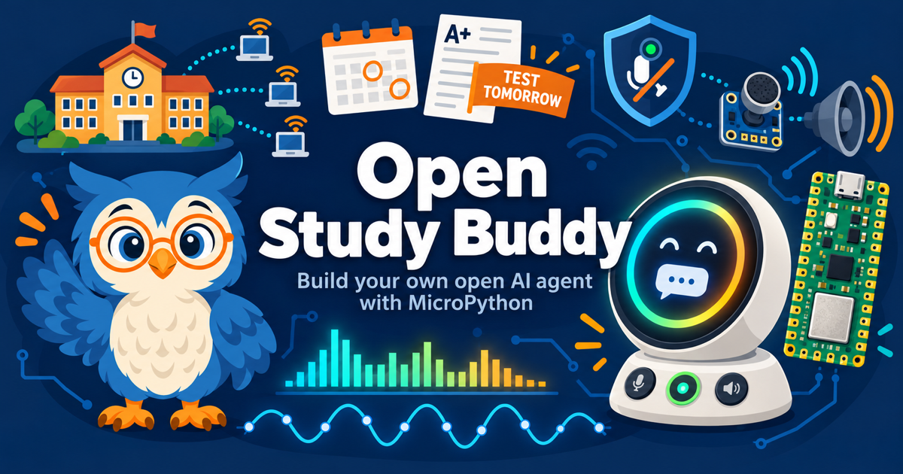

# Open Study Buddy

[](https://www.mkdocs.org/)
[](https://squidfunk.github.io/mkdocs-material/)
[](https://dmccreary.github.io/open-study-buddy/)
[](https://claude.ai/code)
[](https://github.com/dmccreary/ibook-skills)
[](https://creativecommons.org/licenses/by-nc-sa/4.0/)
[](https://micropython.org/)
[](https://www.python.org/)
[](https://developer.mozilla.org/en-US/docs/Web/JavaScript)



## View the Live Site

Visit the interactive textbook at: [https://dmccreary.github.io/open-study-buddy/](https://dmccreary.github.io/open-study-buddy/)

## Overview

Open Study Buddy is an interactive intelligent textbook for building a **low-cost, fully open, personal AI agent
device** from parts that cost a few tens of dollars. The device pairs a Raspberry Pi Pico 2 W with a round 360 × 360
color display, an I2S microphone, an I2S speaker amplifier, and three push buttons. Students write every line of the
MicroPython that runs on it. By the end, they own a desk companion that listens, shows what it heard, speaks answers
aloud, and tells them what is due and when the next test is.

Most commercial personal agents are closed, run on a vendor's cloud, and bill a monthly subscription. Open Study Buddy
takes the opposite approach: each person, class, or school sets up the agent behind the device, chooses where it runs,
and decides which data it may touch. A school can connect its agent to the school calendar and give its device its own
mascot on the round display.

The book is written for high school students (grades 9–12) who have completed *Learning MicroPython and Physical
Computing* or have equivalent experience. It is also useful for motivated junior high students, college undergraduates,
coding clubs, hobbyists, and the teachers and mentors who run school maker programs. Learning outcomes follow the 2001
revision of Bloom's Taxonomy, and concepts are sequenced with a dependency-based learning graph so prerequisites always
come first.

### What You Will Build and Learn

- A personal-agent architecture: listen, display, and speak on a Pico, with the thinking done by a swappable agent
- Direct-to-region drawing on a round display instead of slow full-frame updates
- I2S audio recording and playback, plus FFT-based signal processing on live microphone data
- High-performance MicroPython: `@micropython.viper`, assembly inner loops, and allocation-free real-time code
- Push-to-talk and wake-word detection, with honest limits on what template matching can do
- Wi-Fi, HTTP, and streaming to an agent, then MQTT push alerts such as "test tomorrow"
- Configuring a school agent with calendar data
- Privacy, safety, and responsible listening for a device that hears its surroundings

## Site Status

The book is under active development. The course description, learning graph, chapter drafts, and the learning graph
viewer MicroSim are in place. Glossary, FAQ, quizzes, references, and additional MicroSims are still to come. Site
metrics will be added to this README once the supplementary content has been generated.

## Getting Started

### Clone the Repository

```bash
git clone https://github.com/dmccreary/open-study-buddy.git
cd open-study-buddy
```

### Install Dependencies

This project uses MkDocs with the Material theme:

```bash
pip install mkdocs mkdocs-material
```

### Build and Serve Locally

Build the site (strict mode turns broken links and missing files into errors):

```bash
mkdocs build --strict
```

Serve locally with live reload:

```bash
mkdocs serve
```

Open your browser to `http://127.0.0.1:8000/open-study-buddy/`.

### Deploy to GitHub Pages

```bash
mkdocs gh-deploy
```

This builds the site and pushes it to the `gh-pages` branch.

### Using the Book

- Use the left sidebar to browse chapters, the learning graph, and MicroSims
- Use the search icon to search all content
- Chapters build on each other; each one ends with a working feature on the device
- MicroSims run standalone in the browser and are embedded in chapters with an `iframe`

### Customization

- Edit Markdown files in `docs/` to change content
- Edit `mkdocs.yml` to change site structure and navigation
- Add your own MicroSims in `docs/sims/<sim-id>/`
- Adjust the look and feel in `docs/css/extra.css`

## Repository Structure

```text
open-study-buddy/
├── docs/                          # MkDocs documentation source
│   ├── chapters/                  # One directory per chapter
│   │   ├── 01-personal-agents-architecture/
│   │   │   └── index.md           # Chapter content
│   │   └── ...
│   ├── learning-graph/            # Concept list, taxonomy, dependency graph, quality reports
│   ├── sims/                      # Interactive MicroSims
│   │   └── graph-viewer/          # Learning graph viewer
│   ├── img/                       # Cover image, favicon, license badge, mascot poses
│   ├── css/                       # extra.css and mascot.css
│   ├── course-description.md      # Seed document for the learning graph and chapters
│   └── license.md                 # Creative Commons license details
├── src/
│   └── kits/
│       └── study-buddy-base/      # MicroPython source for the device
├── plugins/
│   └── social_override.py         # og:/twitter: meta-tag hook
├── CONTENT-GENERATION-GUIDE.md    # Content rules for authors and AI agents
├── AGENTS.md                      # Entry point for AI coding agents
├── mkdocs.yml                     # MkDocs configuration and navigation
└── README.md                      # This file
```

## Reporting Issues

Found a bug, typo, or have a suggestion for improvement? Please report it:

[GitHub Issues](https://github.com/dmccreary/open-study-buddy/issues)

When reporting issues, please include:

- A description of the problem or suggestion
- Steps to reproduce (for bugs)
- Expected versus actual behavior
- Screenshots, if applicable
- Browser and environment details (for MicroSims)

## License

This work is licensed under the
[Creative Commons Attribution-NonCommercial-ShareAlike 4.0 International License](https://creativecommons.org/licenses/by-nc-sa/4.0/).

**You are free to:**

- **Share** — copy and redistribute the material in any medium or format
- **Adapt** — remix, transform, and build upon the material

**Under the following terms:**

- **Attribution** — give appropriate credit with a link to the original
- **NonCommercial** — no commercial use without permission
- **ShareAlike** — distribute contributions under the same license

See [docs/license.md](docs/license.md) for full details.

## Acknowledgements

This project is built on the shoulders of the open source community:

- **[MkDocs](https://www.mkdocs.org/)** - Static site generator for project documentation
- **[Material for MkDocs](https://squidfunk.github.io/mkdocs-material/)** - Responsive documentation theme
- **[MicroPython](https://micropython.org/)** - Python for microcontrollers
- **[Raspberry Pi Pico](https://www.raspberrypi.com/products/raspberry-pi-pico-2/)** - The low-cost microcontroller at the heart of the kit
- **[vis-network](https://visjs.org/)** - Network visualization library for the learning graph viewer
- **[Python](https://www.python.org/)** - Data processing and analysis scripts
- **[Claude](https://claude.ai)** by Anthropic - AI-assisted content generation
- **[GitHub Pages](https://pages.github.com/)** - Free hosting for open source projects

## Contact

**Dan McCreary**

- LinkedIn: [linkedin.com/in/danmccreary](https://www.linkedin.com/in/danmccreary/)
- GitHub: [@dmccreary](https://github.com/dmccreary)

Questions, suggestions, or collaboration opportunities? Feel free to connect on LinkedIn or open an issue on GitHub.
