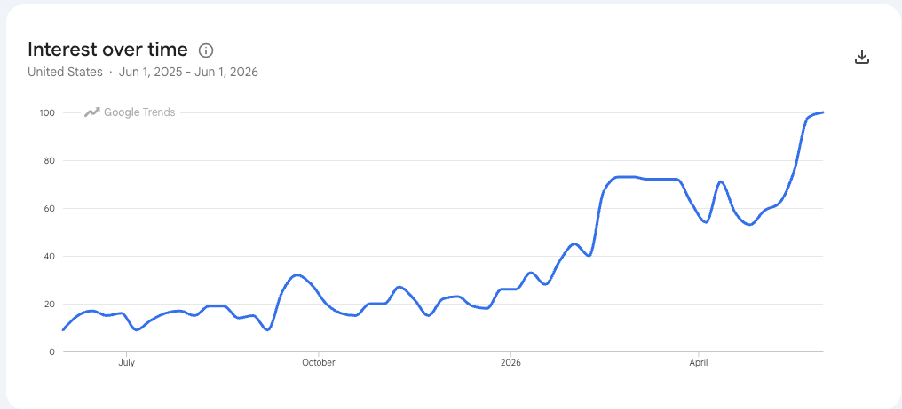

# About This Book

!!! mascot-welcome "Welcome, builders!"
    { class="mascot-admonition-img" }
    I'm Sage, and this book is about building a desk companion that listens, shows what it heard, and talks back. You'll write every line of code that runs on it, from the microphone to the round screen to the network link. When you're done, it's yours — your buddy, your rules, your data. Let's listen closely!

**Open Study Buddy** is a free, open textbook for building a low-cost personal AI
agent device from a Raspberry Pi Pico 2 W, a 2.1-inch round color display, a
digital microphone, a speaker amplifier, and three buttons. Students write the
MicroPython that runs it. Schools set up the agent behind it, decide which data
it may touch, and give it their own mascot and calendar.

## Why Now

Five years ago this device could not have been built for the price of a pizza
dinner. Today it can. The sections below explain what changed — the demand side
(students want fun projects, and the world wants personal agents) and the supply
side (displays, audio parts, and microcontroller DSP all crossed a price and
performance line at the same time).

### We Need Fun Coding Projects

Most students do not quit programming because loops are hard. They quit because
the projects are boring: print a times table, sort a list, guess a number. The
projects that keep students coming back share three traits:

- **Hands-on.** The code makes something happen in the physical world — a screen
  lights up, a speaker answers, a button changes the mode. Mistakes are visible
  and fixes are satisfying.
- **Personal.** The student owns the result. It wears their school's mascot,
  shows their test dates, answers to their wake phrase, and sits on their desk
  after the class ends.
- **Affordable.** The whole kit has to cost **under $30**, so a club can buy one
  per student, a parent can say yes without a second thought, and a broken part
  is a shrug instead of a crisis.

The Study Buddy base kit hits all three. At single-unit prices the parts come to
about **$28**, and a classroom order of 20 drops to about **$21 per student**
(see the [Purchasing Guide](learning-graph/teachers-guide/index.md#purchasing-guide)
for every part, price, and search link). That is less than one month of most
commercial personal-agent subscriptions.

### The Rise of Personal Agents

A **personal agent** is AI software that does multi-step work on your behalf —
checking a calendar, summarizing what is due, and coming back when it needs a
decision. In the twelve months from June 2025 to June 2026, U.S. Google search
interest in "personal AI agents" grew **more than tenfold**, from an index of
about 9 to the maximum of 100[^1].



*Google Trends, "Personal AI Agents," United States, June 1, 2025 – June 1, 2026.
Source: [Personal Agent Software](https://dmccreary.github.io/ai-for-ee-research/appendices/personal-agent-software/)
appendix, AI for EE Research.*

The products driving that curve — Google's Gemini Spark, Meta's Muse, OpenAI's
Dots, SpaceXAI's Grok Bot, and Anthropic's Claude Cowork — all launched or
reached general availability within about six months of each other in 2026[^1].
Nearly all of them run on a vendor's cloud computer and bill a monthly
subscription, and none of them shows students how an agent actually works.

Open Study Buddy takes the opposite approach. The device is fully open, the
agent behind it is chosen and configured by the student, class, or school, and
every byte that leaves the device is a byte the student wrote code to send.
Students learn the most important technology trend of their generation by
building a small, honest version of it.

### Lower Display Costs

A personal agent needs a face. The kit uses a **2.1-inch, 360 × 360 round color
display** with the GC9B72 controller — the same class of panel found in
smartwatches. Single displays sell on AliExpress for about **$5.39–$6.12**, or
**under $7** delivered[^2]. A display this large and this sharp used to cost
more than the rest of the kit combined.

For school purchasing, see this book's
[Purchasing Guide](learning-graph/teachers-guide/index.md#21-inch-round-display-gc9b72-360x360)
and the Coding Club textbook's
[Study Buddy Kit](https://dmccreary.github.io/coding-club/kits/study-buddy/) page
and [Chapter 22: Purchasing and Configuring Club Devices](https://dmccreary.github.io/coding-club/chapters/22-purchasing-configuring-devices/)[^3].

### Efficient Sound Processing

Listening and speaking are hard work for a microcontroller: audio arrives as a
continuous stream of samples that must never be dropped. Current MicroPython
releases include `machine.I2S`, and on the Raspberry Pi Pico the RP2 port drives
the I2S bus with **PIO** (programmable I/O) state machines and moves every sample
with **DMA** (direct memory access) running in the background[^4][^5].

That means the bit clock, word select, and data shifting for **both** the
microphone and the speaker run on dedicated hardware, not on the CPU. The
Pico 2 W's processor only touches the audio after a whole buffer is full, which
leaves it free to run the FFT, update the display, and talk to the network. The
RP2350 has three PIO blocks with twelve state machines in total, so the two audio
streams use only a fraction of what is available.

### DSP Functions on a $7 Microcontroller

The RP2350 chip on the Pico 2 W has a hardware floating-point unit and ARM DSP
instructions. The companion [FFT Benchmarking](https://dmccreary.github.io/fft-benchmarking/)
project used them to build a hand-written assembly FFT that MicroPython can call
directly. On a Pico 2 at 150 MHz it computes a **512-bin FFT in about 620
microseconds** (621.7 µs mean, best of 15 trials) — about **289 times faster**
than the same transform in pure interpreted MicroPython, and about 5 times faster
than the published MicroPython assembly FFT for the same board[^6][^7].

The Study Buddy reads audio in 40 ms frames of 512 samples. An FFT that finishes
in about 0.62 ms uses under 2% of each frame, leaving the rest of the time
budget for volume meters, spectrum displays, and wake-word matching — all on a
board that costs **$6.99**[^2].

### High-Quality MEMS Microphone

The kit's ear is the **INMP441**, an omnidirectional MEMS microphone with a
built-in analog-to-digital converter that sends 24-bit samples straight out over
I2S. Its datasheet specifies a **61 dBA signal-to-noise ratio** and a flat
response from 60 Hz to 15 kHz, which covers the human voice with room to
spare[^8]. Breakout boards sell for **about $1–$3**[^2].

The INMP441 has become the default microphone for hobbyist voice projects: it is
the part most often wired into ESP32 and Pico voice assistants, wake-word
detectors, and sound-level loggers, and electronics component libraries carry
many ready-made example circuits for it[^9]. Because it outputs digital audio,
students never fight with analog noise, gain stages, or ADC calibration before
they hear their first clean recording.

<!-- TODO (Dan): add a popularity metric for the INMP441 here — for example
     AliExpress order counts, GitHub search hits, or a Google Trends chart. -->

### High-Quality Sound Amplifier

The kit's voice is the **MAX98357A**, a mono Class D amplifier from Analog
Devices (formerly Maxim Integrated) that takes digital I2S audio in and drives a
speaker directly. It delivers up to **3.2 W into a 4 Ω speaker**, needs no
output filter and no master clock, and accepts sample rates from 8 kHz to
96 kHz[^10]. Class D designs like this one run at roughly 90% efficiency, so the
amplifier stays cool on USB power[^11].

Breakout boards cost **about $1–$2** on AliExpress[^2]. For the price of a candy
bar, students get a clean digital audio path from their code to the speaker, with
no analog circuitry to tune.

### The Growth of Smart Clocks that Use Wi-Fi

!!! note "Placeholder — data to be added"
    <!-- TODO (Dan): add the Google Trends data and a one-paragraph
         justification for the growth of Wi-Fi smart clocks here. -->
    This section will show the growth in U.S. search interest in "WiFi Clock" over
    the last year. Until the chart is added, view the live data in
    [Google Trends: "WIFI Clock," United States, past 12 months](https://trends.google.com/explore?q=WIFI%20Clock&date=today%201-y&geo=US).

<!-- TODO (Dan): save the Google Trends chart as
     docs/img/google-trends-wifi-clock.png and replace the note above with:
     
-->

A Wi-Fi clock is the gateway project to a personal agent. It already has the
round display, the network connection, and the habit of sitting on a desk and
being glanced at all day. The Open Study Buddy grows directly out of the
[Clocks and Watches](https://dmccreary.github.io/clocks-and-watches/) textbook
and its Chrono Smart Clock kit, which uses the same round display. Students who
have built a smart clock already own most of the hardware; adding a microphone,
an amplifier, and a speaker turns the clock into a buddy.

### The Time Is Now!

Every piece of this project crossed a line in the same short window: demand for
personal agents exploded, smartwatch displays fell under $7, MicroPython's I2S
support moved audio onto PIO hardware, a $7 microcontroller learned to run a
512-bin FFT in well under a millisecond, and studio-quality digital microphones
and amplifiers dropped to a couple of dollars each. Put together, they make a
hands-on, personal, fully open AI device that a student can build for under $30.

**The time is now!**

## How to Use This Book

Each chapter builds on the previous one and ends with a working device feature,
so reading in order is recommended. The book includes:

- **18 chapters** covering personal agents, MicroPython review, digital audio,
  the kit hardware, the round display, buttons and device modes, I2S audio, the
  FFT, high-performance MicroPython, push-to-talk, wake words, Wi-Fi and HTTP,
  MQTT alerts, the school agent and calendar, privacy, and capstone projects
- **More than 40 interactive MicroSims** — browser-based simulations you can
  manipulate to explore a concept before you code it
- **A glossary** of 326 terms
- **A learning graph** of 326 concepts showing how every idea depends on the
  ones before it
- **School pages** showing how a school customizes its own buddy
- **A Teacher's Guide** with a full purchasing guide for classroom orders

The [Learning Graph](learning-graph/index.md) shows how concepts connect across
chapters. Start there if you want to explore out of order or check the
prerequisites for a topic.

## About the Author

{ width="150px" align="right" }

Dan McCreary is a semi-retired AI researcher, solution architect, and educator
who has spent more than three decades helping Fortune 100 organizations reason
over massive datasets. At Optum he founded the Generative AI Center of Excellence
and led the team that built one of the world's largest healthcare knowledge
graphs — spanning over 25 billion vertices — to unify member, provider, and
patient insights. His background in knowledge representation and systems
thinking underpins the learning graphs and intelligent-textbook workflows used
throughout this course.

He is the co-author of *Making Sense of NoSQL* (Manning Publications), the
founding chair of the NoSQL Now! conference, and a frequent keynote speaker on
semantic search, ontology strategy, and AI hardware. Dan has mentored students
as a STEM volunteer since 2014 and runs coding clubs built around low-cost
MicroPython kits. You can visit the
[Intelligent Textbooks Case Studies](https://dmccreary.github.io/intelligent-textbooks/case-studies/)
to see the textbooks Dan has created or co-created with other authors.

**Selected Credentials**

- B.A. in Physics and Computer Science from Carleton College
- M.S.E.E. from the University of Minnesota
- MBA coursework at the University of St. Thomas
- Patent holder in semantic search and ontology management techniques
- Advocate for large-scale Enterprise Knowledge Graph adoption across
  healthcare and education
- Long-time promoter of accessible, low-cost AI-powered learning experiences

## How to Cite This Book

If you reference this textbook in academic work, curriculum proposals, lesson
plans, or grant applications, please use one of the following formats.

**APA (7th edition)**

McCreary, D. (2026). *Open Study Buddy*. https://dmccreary.github.io/open-study-buddy/

**Chicago (17th edition)**

McCreary, Dan. 2026. *Open Study Buddy*. https://dmccreary.github.io/open-study-buddy/.

**MLA (9th edition)**

McCreary, Dan. *Open Study Buddy*. 2026, dmccreary.github.io/open-study-buddy/.

**BibTeX**

```bibtex
@book{mccreary2026openstudybuddy,
  title     = {Open Study Buddy},
  author    = {McCreary, Dan},
  year      = {2026},
  url       = {https://dmccreary.github.io/open-study-buddy/},
  note      = {Interactive intelligent textbook}
}
```

To cite a specific chapter, add the chapter number and title — for example:

McCreary, D. (2026). Chapter 1: Personal Agents and the Open Study Buddy
Architecture. In *Open Study Buddy*.
https://dmccreary.github.io/open-study-buddy/chapters/01-personal-agents-architecture/

## License

This work is released under the
[Creative Commons Attribution-NonCommercial-ShareAlike 4.0 International License
(CC BY-NC-SA 4.0)](license.md). You are free to share and adapt the material for
non-commercial purposes as long as you give appropriate credit and share your
adaptations under the same license.

## References

[^1]: McCreary, D. (2026). *Appendix: Personal Agent Software* (includes the Google Trends chart for "Personal AI Agents," June 1, 2025 – June 1, 2026). AI for EE Research. https://dmccreary.github.io/ai-for-ee-research/appendices/personal-agent-software/
[^2]: McCreary, D. (2026). *Purchasing Guide* (prices checked October 20, 2026). Open Study Buddy Teacher's Guide. https://dmccreary.github.io/open-study-buddy/learning-graph/teachers-guide/#purchasing-guide
[^3]: McCreary, D. (2026). *Study Buddy Kit* and *Chapter 22: Purchasing and Configuring Club Devices*. Coding Club. https://dmccreary.github.io/coding-club/kits/study-buddy/
[^4]: MicroPython. *class I2S – Inter-IC Sound bus protocol*. MicroPython documentation. https://docs.micropython.org/en/latest/library/machine.I2S.html
[^5]: MicroPython. `ports/rp2/machine_i2s.c` — "The PIO is used to drive the I2S bus signals" with non-blocking DMA transfers. https://github.com/micropython/micropython/blob/master/ports/rp2/machine_i2s.c
[^6]: McCreary, D. (2026). *Appendix: How Our 512-Point Assembly FFT Compares to Published Libraries*. FFT Benchmarking. https://dmccreary.github.io/fft-benchmarking/appendices/benchmark-comparison/
[^7]: Hinch, P. *micropython-fourier*. GitHub. https://github.com/peterhinch/micropython-fourier
[^8]: TDK InvenSense. *INMP441 Omnidirectional Microphone with Bottom Port and I2S Digital Output* (datasheet). https://invensense.tdk.com/products/digital/inmp441/
[^9]: Cirkit Designer. *INMP441 Microphone* (component page with example projects). https://docs.cirkitdesigner.com/component/3c3f5670-82f7-4ecc-9dc1-bcd3eb8732bf/inmp441-microphone
[^10]: Analog Devices. *MAX98357A/MAX98357B: Tiny, Low-Cost, PCM Class D Amplifier with Class AB Performance* (datasheet). https://www.analog.com/en/products/max98357a.html
[^11]: Soldered Electronics. *I2S Audio Amplifier — How It Works* (MAX98357A, 92% efficiency at 3.2 W into 4 Ω). https://docs.soldered.com/i2s-audio-amplifier/how-it-works/
