# Sample Gallery

Every program you can run on the Study Buddy, with a picture of what it puts
on the round screen. Use it to find a sample to try, a program to take apart,
or an idea for your own project.

**76 samples in all:** 47 that run today and 29 ideas waiting to be built.

| Section | Samples |
|---|---:|
| [The Labs](#the-labs) | 19 |
| [The Demos](#the-demos) | 12 |
| [Smart Clock Faces](#smart-clock-faces) | 16 |
| [Future Clock Faces](#future-clock-faces) | 16 |
| [Future Study Tools](#future-study-tools) | 13 |
| **Total** | **76** |

Each card has a difficulty level:

Beginner short programs, one
idea, nothing to change before you run them. 
Intermediate several ideas
together: timing, state machines, sound, or the network. 
Advanced programs that manage
memory, signal processing, or many modes at once. 
Idea a sample nobody has written
yet. Its picture is concept art, not a screenshot.

The screenshots of the labs, demos, and clock faces come from their real
MicroPython code, run through a desktop simulator of the GC9B72 display.
[`scripts/render-gallery-images.py`](https://github.com/dmccreary/open-study-buddy/blob/main/scripts/render-gallery-images.py)
makes every image on this page again after a program changes.

## The Labs

Nineteen short programs in [`src/kits/study-buddy-base`](https://github.com/dmccreary/open-study-buddy/tree/main/src/kits/study-buddy-base). Labs 01 to 07 check each part as you wire it; labs 08 to 19 teach one idea each. Every card links to the lab's page.

-   **[Lab 01: Blink the Onboard LED](../kits/study-buddy-base/01-blink.md)**

    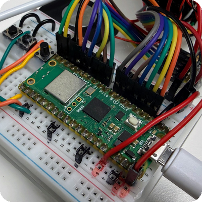{ .osb-screen }

    Make the Pico's own LED blink. The first proof that your board, cable, and MicroPython all work.

    Beginner

-   **[Lab 02: The Hardware Probe](../kits/study-buddy-base/02-probe.md)**

    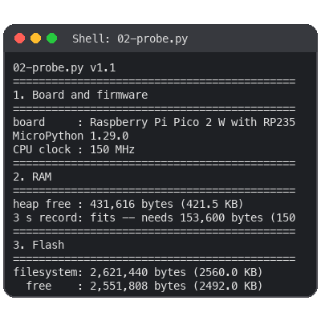{ .osb-screen }

    A checkup that reports the board, memory, flash, and every wire it can test, and warns about the ones that look wrong.

    Beginner

-   **[Lab 03: Buttons on the Console](../kits/study-buddy-base/03-buttons.md)**

    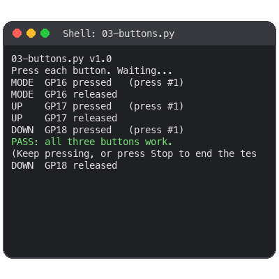{ .osb-screen }

    Press MODE, UP, and DOWN and watch each press and release appear in the shell.

    Beginner

-   **[Lab 04: Hello World on the Display](../kits/study-buddy-base/04-hello-world.md)**

    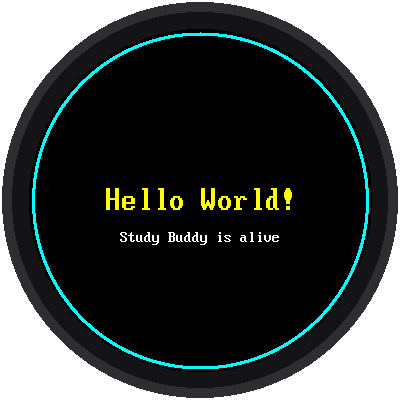{ .osb-screen }

    The smallest program that lights up the round 360 x 360 screen.

    Beginner

-   **[Lab 05: Speaker Tones](../kits/study-buddy-base/05-speaker-tones.md)**

    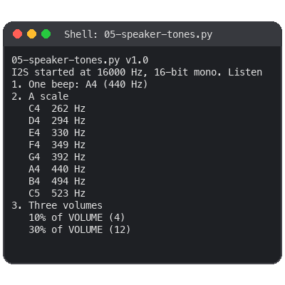{ .osb-screen }

    A beep, a musical scale, and three volumes from the I2S amplifier and speaker.

    Beginner

-   **[Lab 06: Listen with the Microphone](../kits/study-buddy-base/06-listen-meter.md)**

    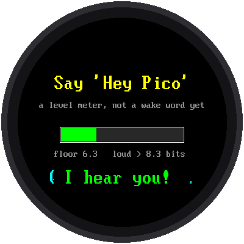{ .osb-screen }

    A live loudness meter that measures the quiet room first, then reacts when you talk.

    Beginner

-   **[Lab 07: Hold to Record, Release to Play Back](../kits/study-buddy-base/07-record-playback.md)**

    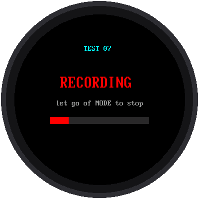{ .osb-screen }

    Hold MODE and talk; let go and hear yourself. The first program that uses every part of the kit.

    Intermediate

-   **[Lab 08: How the Display Mixes Color](../kits/study-buddy-base/08-color-mixing.md)**

    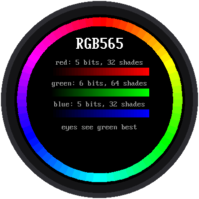{ .osb-screen }

    RGB565 explained on the glass: 5 bits of red, 6 of green, 5 of blue.

    Beginner

-   **[Lab 09: Angles to Pixels](../kits/study-buddy-base/09-angles-to-pixels.md)**

    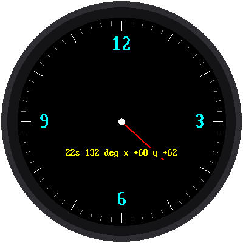{ .osb-screen }

    Use sine and cosine to turn an angle into a point. The math behind every analog clock face.

    Intermediate

-   **[Lab 10: Flicker-Free Text](../kits/study-buddy-base/10-flicker-free-text.md)**

    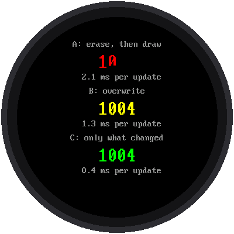{ .osb-screen }

    Three ways to update a number, raced side by side, so you can see why sending less is faster.

    Intermediate

-   **[Lab 11: What a Button Press Really Looks Like](../kits/study-buddy-base/11-button-bounce.md)**

    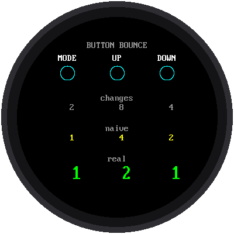{ .osb-screen }

    Count the extra presses a bouncing contact makes, then fix them with debouncing.

    Intermediate

-   **[Lab 12: One Loop, Many Jobs](../kits/study-buddy-base/12-one-loop-many-jobs.md)**

    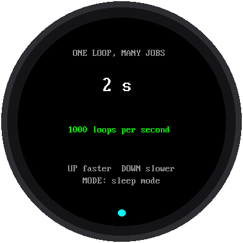{ .osb-screen }

    Blink, count, animate, and read buttons at once by checking the clock instead of sleeping.

    Intermediate

-   **[Lab 13: Modes as a State Machine](../kits/study-buddy-base/13-modes-state-machine.md)**

    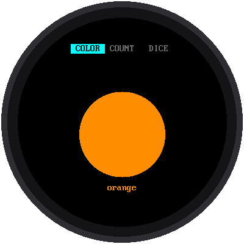{ .osb-screen }

    MODE steps through three modes held in a table of states, the pattern every demo uses.

    Intermediate

-   **[Lab 14: Samples Make Sound](../kits/study-buddy-base/14-samples-make-sound.md)**

    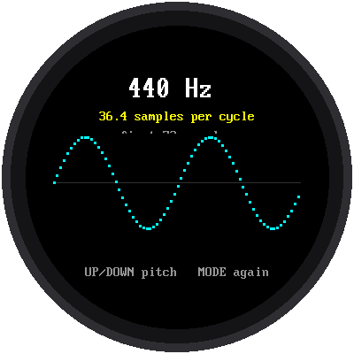{ .osb-screen }

    Build a sine wave one number at a time and hear what sample rate and aliasing do.

    Intermediate

-   **[Lab 15: Envelopes](../kits/study-buddy-base/15-sound-envelopes.md)**

    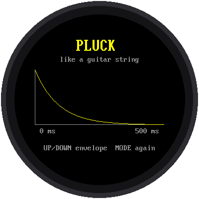{ .osb-screen }

    Play the same notes as a pluck, an organ, and more, and see each envelope's shape.

    Intermediate

-   **[Lab 16: A Microphone Oscilloscope](../kits/study-buddy-base/16-mic-oscilloscope.md)**

    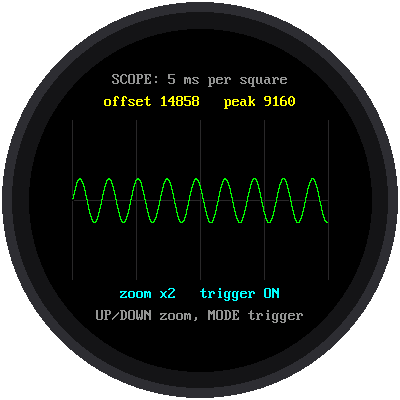{ .osb-screen }

    Watch the sound the microphone hears as a live wave, with DC offset, gain, and a trigger.

    Advanced

-   **[Lab 17: A Whistle Tuner](../kits/study-buddy-base/17-whistle-tuner.md)**

    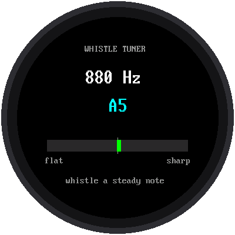{ .osb-screen }

    Whistle a note and see its frequency, its name, and how many cents sharp or flat you are.

    Advanced

-   **[Lab 18: From Radio Waves to the Weather](../kits/study-buddy-base/18-network-layers.md)**

    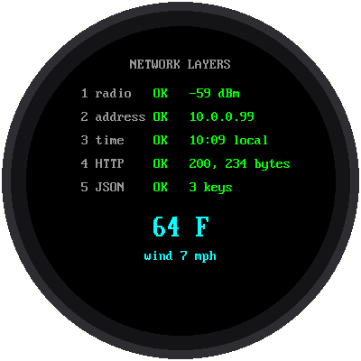{ .osb-screen }

    WiFi, an IP address, NTP time, HTTP, and JSON, checked off one layer at a time.

    Intermediate

-   **[Lab 19: Pattern Memory Game](../kits/study-buddy-base/19-pattern-game.md)**

    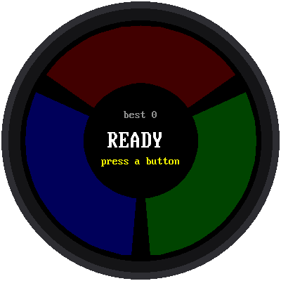{ .osb-screen }

    Repeat a growing pattern of colored wedges and notes. A game that uses everything before it.

    Advanced

## The Demos

Eleven demos and the showcase that ties them together. Copy `main.py` to the Pico and they run at power-up. See [The Finished Demo](../kits/study-buddy-base/intro.md#the-finished-demo) for the buttons.

-   **[The Showcase](../kits/study-buddy-base/intro.md#the-finished-demo)**

    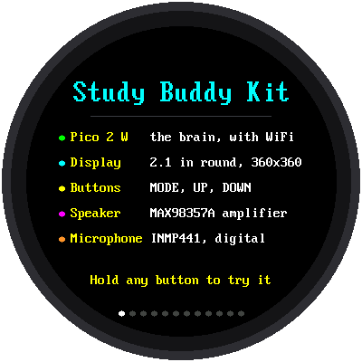{ .osb-screen }

    The power-up screen. It steps through every demo; hold any button to try one. Each demo loads only while it is on screen.

    Advanced

-   **[Clock and Weather](../kits/study-buddy-base/intro.md#the-finished-demo)**

    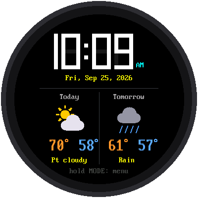{ .osb-screen }

    Sets its own time over WiFi and shows a two-day forecast with weather icons.

    Intermediate

-   **[Alarm Clock](../kits/study-buddy-base/intro.md#the-finished-demo)**

    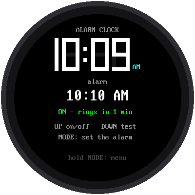{ .osb-screen }

    Set the alarm with three buttons. It rings from any demo when it is due.

    Intermediate

-   **[Countdown Timer](../kits/study-buddy-base/intro.md#the-finished-demo)**

    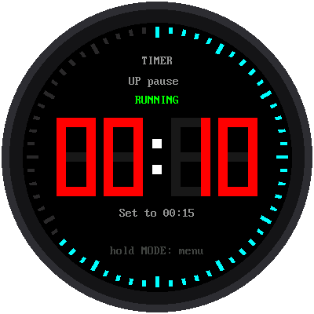{ .osb-screen }

    Presets, a tick ring that counts down, and an alarm that keeps going after you leave.

    Intermediate

-   **[Stopwatch](../kits/study-buddy-base/intro.md#the-finished-demo)**

    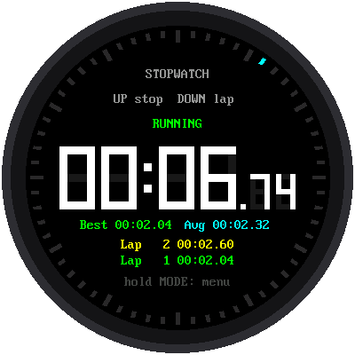{ .osb-screen }

    Start, stop, and laps, with the best and average lap times.

    Beginner

-   **[School Calendar](../kits/study-buddy-base/intro.md#the-finished-demo)**

    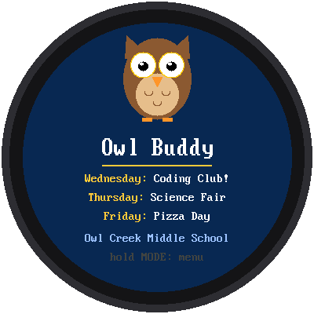{ .osb-screen }

    A school mascot and this week's events. The school-generator skill makes one for your school.

    Beginner

-   **[Sound Lab](../kits/study-buddy-base/intro.md#the-finished-demo)**

    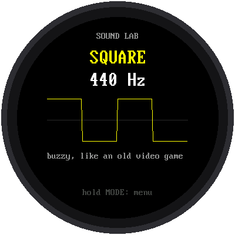{ .osb-screen }

    Hear sine, square, triangle, and sawtooth waves, octaves, and a tune.

    Intermediate

-   **[Sound Meter](../kits/study-buddy-base/intro.md#the-finished-demo)**

    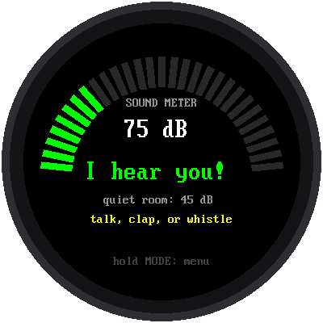{ .osb-screen }

    A curved VU meter with peak hold that responds to talking, clapping, and whistling.

    Intermediate

-   **[Record and Play](../kits/study-buddy-base/intro.md#the-finished-demo)**

    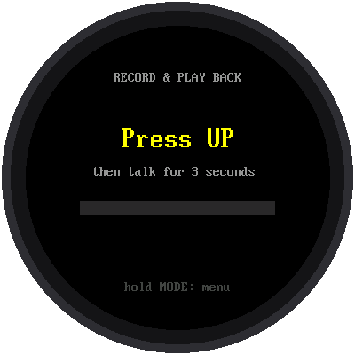{ .osb-screen }

    Record three seconds and play them back. The recording buffer alone needs 150 KB.

    Advanced

-   **[Quote of the Day](../kits/study-buddy-base/intro.md#the-finished-demo)**

    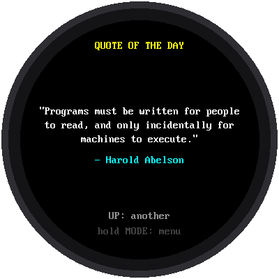{ .osb-screen }

    A new quote each day, word-wrapped to fit the round glass.

    Beginner

-   **[Spanish Quiz](../kits/study-buddy-base/intro.md#the-finished-demo)**

    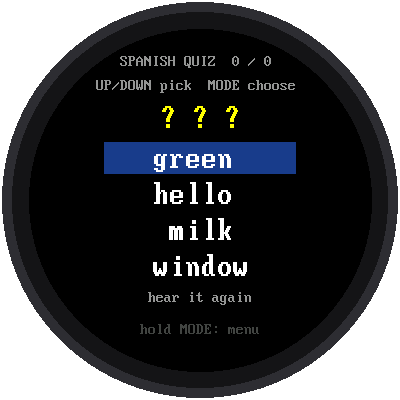{ .osb-screen }

    Hear a Spanish word through the speaker and pick its meaning.

    Intermediate

-   **[Vocabulary Flash Cards](../kits/study-buddy-base/intro.md#the-finished-demo)**

    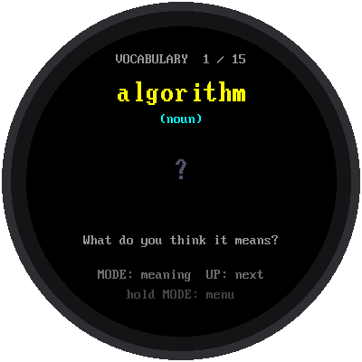{ .osb-screen }

    See a word, think of its meaning, then press MODE to flip the card.

    Beginner

## Smart Clock Faces

These faces come from the [Clocks and Watches](https://dmccreary.github.io/clocks-and-watches/)
book, from three kits that use the same 2.1-inch round GC9B72 display: the
Chrono Smart Clock, the Big Round Speaker Clock, and the Railway Clock. Each
card links to the lab that builds it.

!!! note "Moving a face to the Study Buddy"
    All three clock kits wire the display to the same pins as the Study
    Buddy (GP2 to GP7), but their buttons are on GP13 to GP15, and the Study
    Buddy's are on GP16 to GP18. Run a face with the Study Buddy's own
    `config.py`, not the clock kit's. If the face reads a setting this kit's
    `config.py` does not have, copy that one line across. These faces have
    not yet been run on Study Buddy hardware.

-   **[Digital Clock](https://dmccreary.github.io/clocks-and-watches/kits/sw-gc9b72/03-digital-clock/)**

    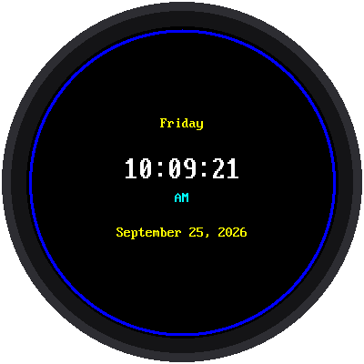{ .osb-screen }

    The time, the day of the week, and the date, updated every second.

    Beginner

-   **[Analog Watch Face](https://dmccreary.github.io/clocks-and-watches/kits/sw-gc9b72/05-analog-watch-face/)**

    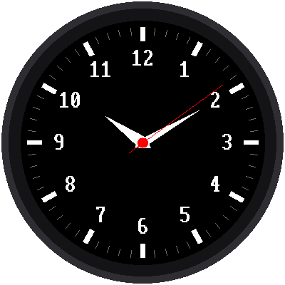{ .osb-screen }

    Sixty tick marks, the numbers 1 to 12, and moving hour, minute, and second hands.

    Intermediate

-   **[Set the Time](https://dmccreary.github.io/clocks-and-watches/kits/sw-gc9b72/07-set-time/)**

    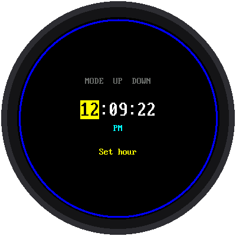{ .osb-screen }

    Set the hours and minutes with the buttons when there is no WiFi.

    Intermediate

-   **[Digital Watch Face](https://dmccreary.github.io/clocks-and-watches/kits/sw-gc9b72/08-digital-watch-face/)**

    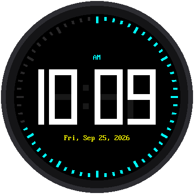{ .osb-screen }

    Digits 114 pixels tall inside a ring of 60 ticks that fills as the seconds pass.

    Intermediate

-   **[Weather Clock](https://dmccreary.github.io/clocks-and-watches/kits/sw-gc9b72/09-weather-clock/)**

    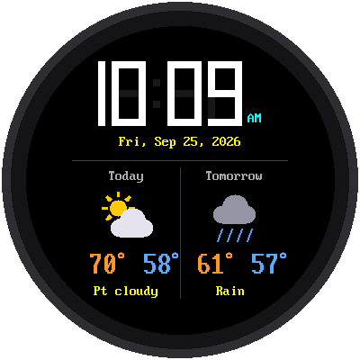{ .osb-screen }

    The time plus today's and tomorrow's forecast from Open-Meteo, a free service with no account.

    Intermediate

-   **[Stopwatch Face](https://dmccreary.github.io/clocks-and-watches/kits/sw-gc9b72/10-stopwatch/)**

    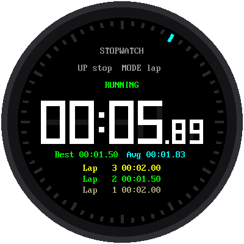{ .osb-screen }

    Minutes, seconds, and hundredths, with a lap time each time you press a button.

    Beginner

-   **[Countdown Face](https://dmccreary.github.io/clocks-and-watches/kits/sw-gc9b72/11-countdown-timer/)**

    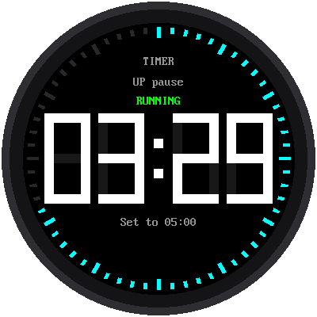{ .osb-screen }

    Set the minutes and seconds, then watch a ring around the edge count down to the alarm.

    Beginner

-   **[Big Clock](https://dmccreary.github.io/clocks-and-watches/kits/big-round-speaker-clock/09-ten-modes/)**

    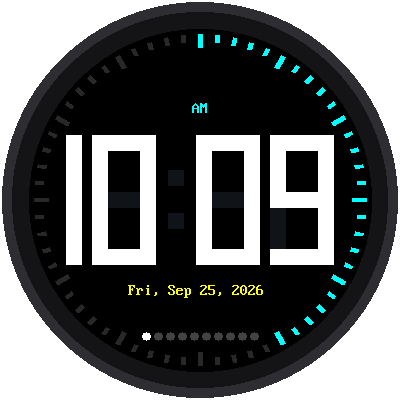{ .osb-screen }

    The biggest digits that fit on the glass, readable across a room.

    Beginner

-   **[Time and Temperature](https://dmccreary.github.io/clocks-and-watches/kits/big-round-speaker-clock/09-ten-modes/)**

    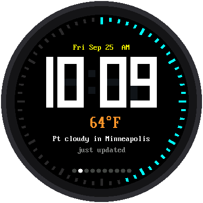{ .osb-screen }

    The time with the temperature outside, refreshed every 30 minutes.

    Intermediate

-   **[Time and Forecast](https://dmccreary.github.io/clocks-and-watches/kits/big-round-speaker-clock/09-ten-modes/)**

    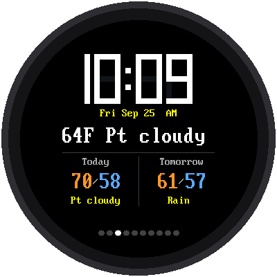{ .osb-screen }

    Adds today's and tomorrow's highs, lows, and weather.

    Intermediate

-   **[Alarm Face](https://dmccreary.github.io/clocks-and-watches/kits/big-round-speaker-clock/09-ten-modes/)**

    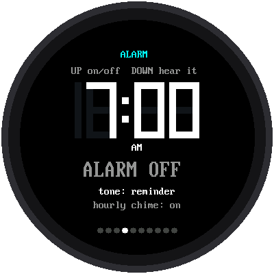{ .osb-screen }

    An alarm with a choice of tones and an hourly chime.

    Intermediate

-   **[Phrase of the Day](https://dmccreary.github.io/clocks-and-watches/kits/big-round-speaker-clock/09-ten-modes/)**

    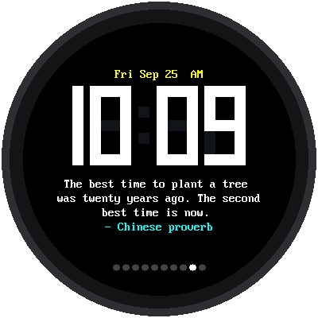{ .osb-screen }

    The time above a daily phrase that is the same for everyone on the same day.

    Intermediate

-   **[Holiday Calendar](https://dmccreary.github.io/clocks-and-watches/kits/big-round-speaker-clock/09-ten-modes/)**

    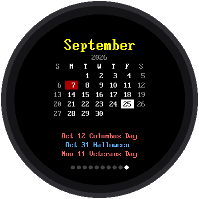{ .osb-screen }

    A month calendar that works out holidays from rules like "the fourth Thursday in November".

    Advanced

-   **[Swiss Railway Clock](https://dmccreary.github.io/clocks-and-watches/kits/mondaine/15-mondaine-clock/)**

    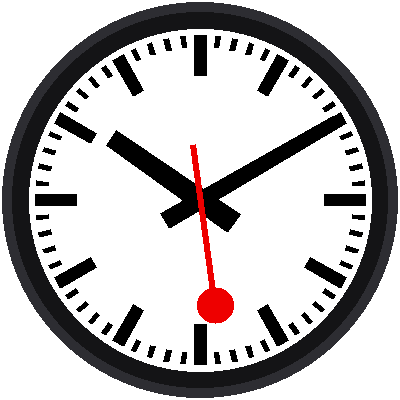{ .osb-screen }

    The station clock whose red second hand pauses at 12 until the minute hand jumps.

    Advanced

-   **[Railway Dial](https://dmccreary.github.io/clocks-and-watches/kits/mondaine/04-minute-markers/)**

    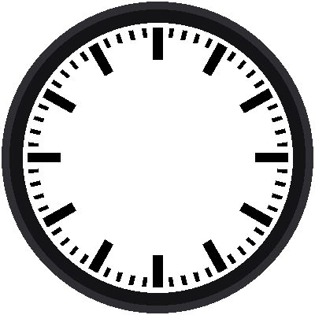{ .osb-screen }

    Just the dial: hour bars and minute marks placed with sine and cosine.

    Beginner

-   **[Smooth Sweep](https://dmccreary.github.io/clocks-and-watches/kits/mondaine/10-smooth-sweep/)**

    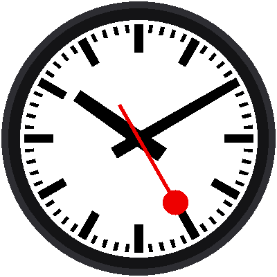{ .osb-screen }

    A second hand that glides instead of ticking, redrawn many times a second.

    Intermediate

## Future Clock Faces

Ideas for watch faces nobody has written yet. The pictures are concept art, drawn to show the idea, not screenshots of working code. Pick one and build it.

-   **Binary Clock**

    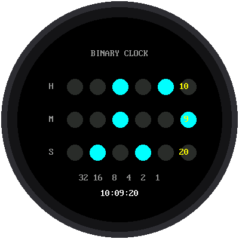{ .osb-screen }

    Hours, minutes, and seconds as rows of lit dots. A direct way to practice binary.

    IdeaBeginner

-   **Word Clock**

    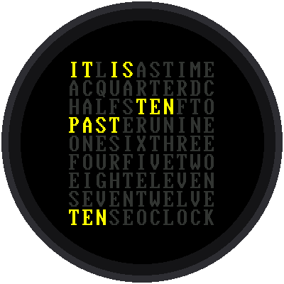{ .osb-screen }

    "IT IS TEN PAST TEN" lit on a grid of letters. The rules for saying the time become a table.

    IdeaIntermediate

-   **Fibonacci Clock**

    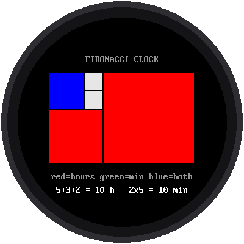{ .osb-screen }

    Colored squares of size 1, 1, 2, 3, and 5 that add up to the hour and minutes.

    IdeaIntermediate

-   **Sun and Moon Dial**

    { .osb-screen }

    A 24-hour dial with daylight as a gold arc, using sunrise and sunset from Open-Meteo.

    IdeaAdvanced

-   **World Clock**

    { .osb-screen }

    Small dials for several cities, using the time-zone math in wifi_time.py.

    IdeaIntermediate

-   **Moon Phase**

    { .osb-screen }

    Today's moon phase, computed on the Pico with no web service.

    IdeaAdvanced

-   **Ring Clock**

    { .osb-screen }

    Three nested arcs fill as the hour, minute, and second go by.

    IdeaIntermediate

-   **Roman Numeral Face**

    { .osb-screen }

    A classic cream dial with Roman numerals and a thin red seconds hand.

    IdeaBeginner

-   **Nixie Tube Style**

    { .osb-screen }

    Orange digits glowing in drawn glass tubes, like a 1960s lab instrument.

    IdeaBeginner

-   **Next Test Countdown**

    { .osb-screen }

    Counts down to your next quiz or test and chimes a day before, whatever is on screen.

    IdeaIntermediate

-   **Bell Schedule**

    { .osb-screen }

    Your class periods as colored arcs, with minutes left in this class and where you go next.

    IdeaIntermediate

-   **Pomodoro Focus Ring**

    { .osb-screen }

    A 25-minute focus timer with a 5-minute break and a dot for each session.

    IdeaBeginner

-   **Minimal Dots**

    { .osb-screen }

    Twelve dots and two hands on navy. Shows how much a face can leave out.

    IdeaBeginner

-   **Orbit Clock**

    { .osb-screen }

    The hour is a planet, the minute a moon, and the second a comet on three orbits.

    IdeaIntermediate

-   **Day Progress**

    { .osb-screen }

    How much of today, the week, the semester, and the year is already done.

    IdeaBeginner

-   **Retro LCD Watch**

    { .osb-screen }

    Seven-segment digits on a gray-green background, like a 1980s digital watch.

    IdeaBeginner

## Future Study Tools

Ideas for samples that help with studying, several taken from the book's later chapters (FFT, wake words, MQTT, and the school agent). These are concept art too.

-   **Flash Quiz**

    { .osb-screen }

    Multiple-choice decks, such as state capitals, that bring back the ones you miss.

    IdeaIntermediate

-   **Math Facts**

    { .osb-screen }

    Times-table drills generated on the Pico, so no deck is needed.

    IdeaBeginner

-   **Homework Checklist**

    { .osb-screen }

    Tonight's assignments, checked off with the buttons.

    IdeaIntermediate

-   **Mode Library**

    { .osb-screen }

    Browse and install new modes and quiz decks from a list your teacher publishes.

    IdeaAdvanced

-   **Push Alerts**

    { .osb-screen }

    Reminders pushed from the school over MQTT, such as a library book due.

    IdeaAdvanced

-   **Hey Pico Wake Word**

    { .osb-screen }

    Wakes up when it hears "Hey Pico" by matching sound features against a template of your voice.

    IdeaAdvanced

-   **Ask Your Buddy**

    { .osb-screen }

    Hold MODE, ask a question, and hear the school agent's answer.

    IdeaAdvanced

-   **Spectrum Analyzer**

    { .osb-screen }

    Live frequency bars from the microphone, computed with an FFT.

    IdeaAdvanced

-   **Ear Trainer**

    { .osb-screen }

    Hear a note and name it. Practice for music class.

    IdeaIntermediate

-   **Metronome**

    { .osb-screen }

    A steady click with a swinging pendulum and adjustable beats per minute.

    IdeaBeginner

-   **Breathing Coach**

    { .osb-screen }

    A circle that grows and shrinks to pace slow breathing before a test.

    IdeaBeginner

-   **Library Voice Meter**

    { .osb-screen }

    A traffic light that turns yellow and red when a study room gets loud.

    IdeaIntermediate

-   **Dice and Picker**

    { .osb-screen }

    Roll one or two dice, or pick who goes first.

    IdeaBeginner

## Add Your Own

Built something new? A sample belongs in this gallery when it runs on the
base kit and has a picture of its screen. Add a line for it to
`scripts/render-gallery-images.py`, run the script, and add a card to this
page. If your program is one of the ideas above, replace its concept art with
the real screenshot and drop the Idea badge.
