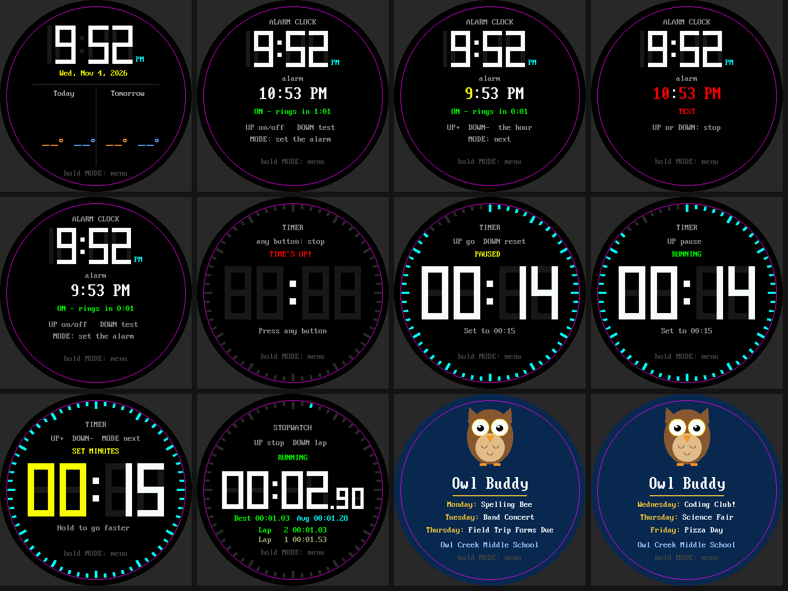
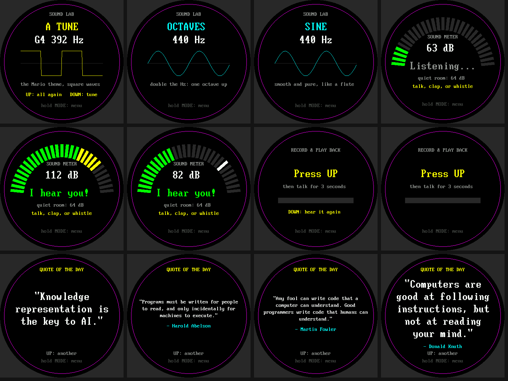

# Study Buddy Base Kit

The **Study Buddy base kit** is a Raspberry Pi Pico 2 W with a 2.1 inch round color display,
three buttons, a microphone, and a speaker. The nineteen labs below teach you to program every part,
one idea per lab. They are written for a student who has finished the
[Learning MicroPython](https://dmccreary.github.io/learning-micropython/) course.

**New here?** Start with [the introduction](intro.md). It describes each part, shows how
they are wired, and explains how to put the lab files on your Pico.

## The Labs

### Part 1: Does It Work?

One test per part, so you can wire the kit a piece at a time and know each piece works before you
add the next.

| Lab | Title | Parts used | What you learn |
|-----|-------|------------|----------------|
| [01](01-blink.md) | Blink the Onboard LED | Pico | Run a program; `Pin("LED")`; `while True` |
| [02](02-probe.md) | The Hardware Probe | Pico, then everything | Let a program inspect its own hardware |
| [03](03-buttons.md) | Buttons on the Console | Buttons | Pull-ups, lists, a first debounce |
| [04](04-hello-world.md) | Hello World on the Display | Display | Coordinates, the round screen, centering text |
| [05](05-speaker-tones.md) | Speaker Tones | Amplifier, speaker | Samples, sine waves, I2S, volume |
| [06](06-listen-meter.md) | Listen with the Microphone | Display, microphone | Loudness, noise floor, logarithms |
| [07](07-record-playback.md) | Hold to Record, Release to Play Back | Button, mic, speaker, display | Buffers, memoryview, converting samples |

### Part 2: How Does It Work?

One idea per lab, each building on the last.

| Lab | Title | Parts used | The big idea |
|-----|-------|------------|--------------|
| [08](08-color-mixing.md) | How the Display Mixes Color | Display | RGB565: 5 + 6 + 5 bits |
| [09](09-angles-to-pixels.md) | Angles to Pixels | Display | Sine and cosine place things on a circle |
| [10](10-flicker-free-text.md) | Flicker-Free Text | Display | Drawing is sending: send only what changed |
| [11](11-button-bounce.md) | What a Button Press Really Looks Like | Buttons, display | Level versus edge, bounce, debounce |
| [12](12-one-loop-many-jobs.md) | One Loop, Many Jobs | LED, buttons, display | Check the clock; don't sleep |
| [13](13-modes-state-machine.md) | Modes as a State Machine | Buttons, display | A state variable and a table of functions |
| [14](14-samples-make-sound.md) | Samples Make Sound | Speaker, display | Sample rate, Nyquist, aliasing |
| [15](15-sound-envelopes.md) | Envelopes | Speaker, display | Why a pluck is not an organ |
| [16](16-mic-oscilloscope.md) | A Microphone Oscilloscope | Mic, display | DC offset, gain, trigger |
| [17](17-whistle-tuner.md) | A Whistle Tuner | Mic, display | Zero crossings, hysteresis, notes and cents |
| [18](18-network-layers.md) | From Radio Waves to the Weather | WiFi, display | Layers: radio, IP, NTP, HTTP, JSON |

### Part 3: Put It All Together

| Lab | Title | Parts used | What you build |
|-----|-------|------------|----------------|
| [19](19-pattern-game.md) | Pattern Memory Game | The whole kit | A game that uses every earlier idea |

## Which Labs Make Sound?

Labs **05, 07, 14, 15, and 19** play sound. Lab 02 never does. If you are somewhere quiet, run
the others first, and keep `VOLUME` in `config.py` low.

## Labs That Need the Internet

Only [Lab 18](18-network-layers.md) needs WiFi and a `secrets.py` file. It is also needed by
the clock and weather screen of the finished demo.

## The Parts at a Glance

| Part | What it does |
|------|--------------|
| **Raspberry Pi Pico 2 W** | The microcontroller, with WiFi and Bluetooth |
| **2.1 inch round color display** | A 360 x 360 pixel GC9B72 screen |
| **MAX98357A amplifier and speaker** | A 3 W amplifier that plays sound |
| **INMP441 microphone** | A low-noise digital microphone |
| **Three buttons** | MODE, UP, and DOWN |
| **Half-size breadboard** | A 400-tie breadboard to hold it all |

## The Software

The kit is programmed in **MicroPython**, using the **Thonny** editor, which is simple enough
for everyone and has debugging tools that experts use too. The `mpremote` command-line tool
copies files to the Pico. All of these are covered in the
[MicroPython Environment](https://dmccreary.github.io/learning-micropython/chapters/03-micropython-environment/)
chapter of the course.

## The Finished Demo

When you have finished the labs, put `main.py` on the Pico and it will run at power-up: a showcase
of twelve screens that include a clock, an alarm, a timer, a stopwatch, school events, tones, a
sound meter, a recorder, a quote of the day, a Spanish quiz, and flash cards.
The [introduction](intro.md#the-finished-demo) lists them all.

