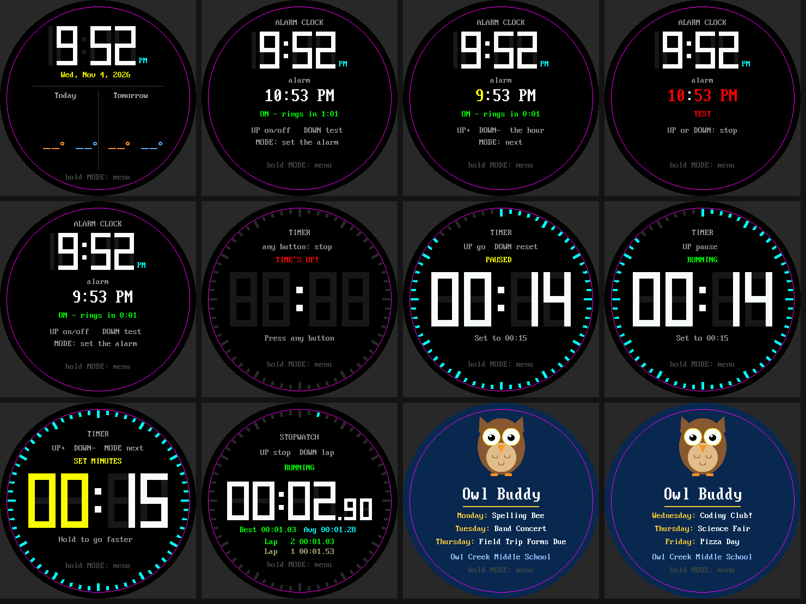
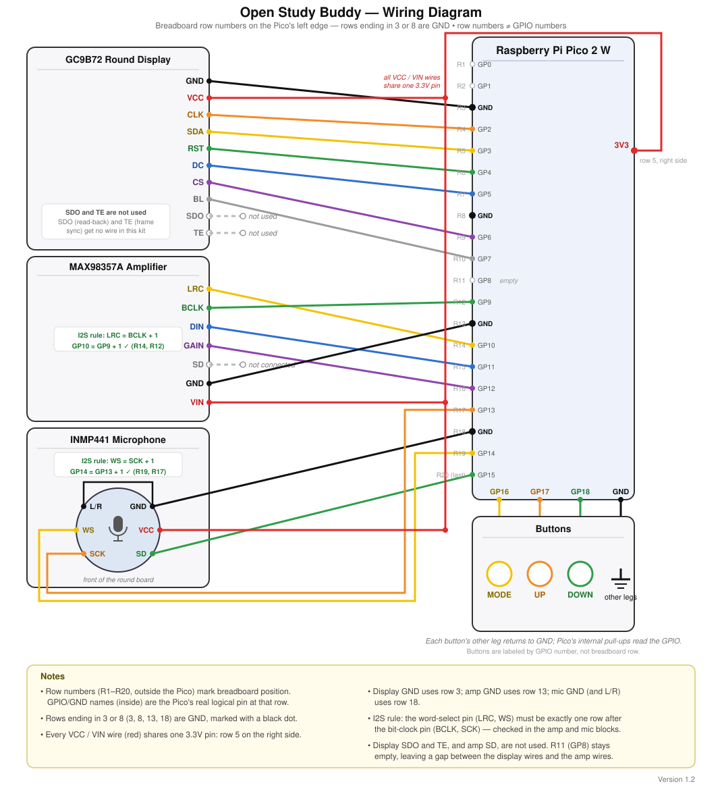

# Meet the Study Buddy Base Kit

!!! mascot-welcome "Your Own Talking, Listening Gadget"
    { class="mascot-admonition-img" }
    By the end of these labs you will have a pocket-sized gadget that shows pictures on a round screen, listens through a microphone, talks through a speaker, and plays a memory game against you. Every program is short enough to read in one sitting, and every one teaches a single idea. Let's listen closely!

The **Study Buddy base kit** is a small computer built from six parts. You already know how to
program a Raspberry Pi Pico from the
[Learning MicroPython](https://dmccreary.github.io/learning-micropython/) course: you can blink
an LED, read a button, and draw on a display. This kit takes those skills and adds three new
ones: a **microphone** that hears, a **speaker** that talks, and a **round color screen** big
enough to show real pictures.



*Twelve screens from the finished demo, each drawn by a MicroPython program you will learn to read
in these labs.*

## The Six Parts

| # | Part | What it does | Wired to |
|---|------|--------------|----------|
| 1 | **Raspberry Pi Pico 2 W** | The brain. A small computer with WiFi that runs your MicroPython programs. | USB cable to your computer |
| 2 | **2.1 inch round display** (GC9B72, 360 x 360 pixels) | Shows text, shapes, and pictures. Only the circle inside the square is visible. | GP2 to GP7, plus 3V3 and GND |
| 3 | **Three push buttons** (MODE, UP, DOWN) | Let you control the program. | GP16, GP17, GP18, each to GND |
| 4 | **INMP441 microphone** | Measures the air pressure of sound, 12,800 times a second. | GP13, GP14, GP15, plus 3V3 and GND |
| 5 | **MAX98357A amplifier and speaker** | Turns the Pico's numbers into sound loud enough to hear. | GP9 to GP12, plus power and GND |
| 6 | **Half-size breadboard and wires** | Holds the parts together without any soldering. | -- |

The microphone and the amplifier both use a way of sending sound called **I2S** (pronounced
"eye-two-ess"). It is a cousin of the I2C and SPI buses you met in the
[Communication Protocols chapter](https://dmccreary.github.io/learning-micropython/chapters/08-communication-protocols/)
of the course. You will meet it properly in Labs 05, 06, and 07.

### The Wiring at a Glance

| Part | Pico pins |
|------|-----------|
| Display: SCL, SDA, RST, DC, CS, BL | GP2, GP3, GP4, GP5, GP6, GP7 (SPI0), plus 3V3 and GND |
| Buttons: MODE, UP, DOWN | GP16, GP17, GP18, each with its other leg to GND |
| Microphone: SCK, WS, SD | GP13, GP14, GP15 (I2S block 1) |
| Microphone: L/R, VDD, GND | L/R to GND, VDD to 3V3, GND to GND |
| Amplifier: BCLK, LRC, DIN | GP9, GP10, GP11 (I2S block 0) |
| Amplifier: GAIN | GP12 |
| Amplifier: VIN, GND | 5 V (VBUS) or 3V3, and GND |

Every pin number lives in one file, `config.py`, and every lab imports it. That means you
never type a pin number into a lab, and if you ever move a wire, you change one line in one
place. The full circuit drawing is below. Click it to see it larger.

[](../../chapters/04-pico-kit-hardware/img/circuit-diagram.svg)

For a guided tour of the parts, try the
[Kit Parts Infographic](../../sims/kit-parts-infographic/index.md), and keep the
[Kit Wiring Fault Finder](../../sims/kit-wiring-fault-finder/index.md) handy for when a wire
goes missing. To wire the display, amplifier and microphone quickly and in the right order,
build the three [wiring harnesses](wiring-harness.md) first.

!!! mascot-warning "Two Wiring Rules That Save Hours"
    { class="mascot-admonition-img" }
    The microphone is a 3.3 volt part, so connect its VDD to **3V3, never 5 V**. Also, the I2S word-select wire (LRC on the amplifier, WS on the microphone) must sit on the pin right after the clock wire (BCLK or SCK), which is why the pins are GP9 and GP10 for the speaker and GP13 and GP14 for the microphone.

## The Software

Every program in this kit is written in **MicroPython** and runs on the Pico 2 W. You will use
the same tools as in the course:

* **MicroPython firmware** for the `RPI_PICO2_W` board. It must be the *W* (wireless)
  version, because the onboard LED is attached to the WiFi chip.
* **Thonny**, a free editor that can run a program on the Pico with the green Run button.
* **mpremote**, a command-line tool that copies files to the Pico and runs programs from a
  terminal. You met it in the
  [MicroPython Environment chapter](https://dmccreary.github.io/learning-micropython/chapters/03-micropython-environment/).

### Putting the Lab Files on the Pico

The labs share a few files, so all of them have to be on the Pico before you run anything
that draws or listens. In a terminal, from the `src/kits/study-buddy-base` folder:

```bash
./upload-code.sh
```

!!! mascot-tip "Quit Thonny First"
    { class="mascot-admonition-img" }
    Only one program can talk to the Pico's USB port at a time, so press Stop and close Thonny's connection before you run `upload-code.sh`. If the script cannot find the Pico, name the port yourself, for example `PORT=/dev/cu.usbmodem14301 ./upload-code.sh`.

The script copies these things to the Pico:

| File or folder | What it holds |
|----------------|---------------|
| `config.py` | Every pin number, color, and setting, plus helper functions such as `init_display()` and `init_buttons()` |
| `lib/gc9b72.py` | The display driver, which knows how to talk to the screen |
| `lib/vga1_8x16.py` and `lib/vga1_bold_16x32.py` | The two fonts: a small one and a big one |
| `lib/shapes.py` | Functions that draw circles, rings, polygons, and triangles |
| `wifi_time.py`, `secrets-template.py` | WiFi helpers (used by Lab 18 and the demo) |
| `01-blink-onboard-led.py` ... `19-pattern-game.py` | The nineteen labs |
| `main.py` and the `demo_*.py` files | The finished demo |

### Your WiFi Secrets

Only Lab 18 and the clock and weather screens of the demo need the internet. They read your
WiFi name and password from a file named `secrets.py`. To make one, copy
`secrets-template.py` to `secrets.py` and fill in two lines:

```python
wifi_ssid = "YourNetworkName"
wifi_pass = "YourPassword"
```

`secrets.py` is listed in `.gitignore` so your password is never uploaded to GitHub. The Pico
only joins **2.4 GHz** networks, not 5 GHz ones.

## How the Labs Are Organized

There are nineteen labs in three groups. Each lab is one program and one idea.

| Group | Labs | The question it answers |
|-------|------|-------------------------|
| **Does it work?** | 01 to 07 | "Is this part wired correctly?" One test per part, then one that uses them all. |
| **How does it work?** | 08 to 18 | "What is really going on inside?" Color, angles, speed, buttons, timing, sound, the microphone, and the internet, one idea per lab. |
| **Put it together** | 19 | "Can I build something with all of it?" A memory game. |

You can wire the kit one part at a time. Run each test as soon as its part is wired.

| Lab | Program | Idea | Parts you need |
|-----|---------|------|----------------|
| [01](01-blink.md) | `01-blink-onboard-led.py` | Does the Pico work? | Pico |
| [02](02-probe.md) | `02-probe.py` | A hardware inspector that checks everything software can check | Pico (plus any parts wired) |
| [03](03-buttons.md) | `03-buttons.py` | Buttons print when pressed | Buttons |
| [04](04-hello-world.md) | `04-hello-world.py` | Text on the round screen | Display |
| [05](05-speaker-tones.md) | `05-speaker-tones.py` | The speaker plays notes | Amplifier, speaker |
| [06](06-listen-meter.md) | `06-listen-meter.py` | The microphone measures loudness | Display, microphone |
| [07](07-record-playback.md) | `07-record-playback.py` | Record your voice and play it back | Button, microphone, speaker, display |
| [08](08-color-mixing.md) | `08-color-mixing.py` | RGB565: how 16 bits make a color | Display |
| [09](09-angles-to-pixels.md) | `09-angles-to-pixels.py` | Sine and cosine put things on a circle | Display |
| [10](10-flicker-free-text.md) | `10-flicker-free-text.py` | Send only what changed | Display |
| [11](11-button-bounce.md) | `11-button-bounce.py` | Edges and contact bounce | Buttons, display |
| [12](12-one-loop-many-jobs.md) | `12-one-loop-many-jobs.py` | Check the clock, don't sleep | LED, buttons, display |
| [13](13-modes-state-machine.md) | `13-modes-state-machine.py` | Modes as a state machine | Buttons, display |
| [14](14-samples-make-sound.md) | `14-samples-make-sound.py` | Sample rate and aliasing | Speaker, display |
| [15](15-sound-envelopes.md) | `15-sound-envelopes.py` | Why a pluck is not an organ | Speaker, display |
| [16](16-mic-oscilloscope.md) | `16-mic-oscilloscope.py` | Draw the sound wave | Microphone, display |
| [17](17-whistle-tuner.md) | `17-whistle-tuner.py` | Measure pitch | Microphone, display |
| [18](18-network-layers.md) | `18-network-layers.py` | From radio waves to the weather | WiFi, display |
| [19](19-pattern-game.md) | `19-pattern-game.py` | A memory game using everything | The whole kit |

### What Is on Every Lab Page

Each lab page follows the same pattern, so you always know where to look:

1. **Quick facts**: the program file, the parts, and how long it takes.
2. **The big idea**: the one thing this lab teaches, in plain words.
3. **Walking through the code**: the important parts of the program, explained a few lines at a time.
4. **Run it** and **what PASS looks like**: how to start it and what you should see and hear.
5. **If something goes wrong**: the most common problems and the fix for each.
6. **Try This**: changes for you to make, with hints. This is where the real learning happens.
7. **Check your understanding**: questions to test yourself.

### Running a Lab

Open the lab's `.py` file in Thonny and press Run. Or, from a terminal:

```bash
mpremote run 04-hello-world.py
```

Many labs run until you stop them. Press the red **Stop** button in Thonny, or **Ctrl-C** in a
terminal. Labs that make sound say so at the top of their page, so you can lower the volume
before you start.

!!! mascot-thinking "Tests First, Then Ideas"
    { class="mascot-admonition-img" }
    Notice the pattern: Labs 01 to 07 prove each part works, and Labs 08 to 19 explain *why* it works. A builder who tests each part alone can find a broken wire in minutes, because only one new thing could have gone wrong.

## The Finished Demo

Once you have worked through the labs, upload the demo as the Pico's `main.py` and it will run
every time the Pico gets power, with no computer needed. It starts as a **showcase** that
flips through twelve screens, one for each thing the kit can do. **Hold any button for one
second** to try the demo that is on the screen:

| # | Demo | What it does |
|---|------|--------------|
| 1 | Clock and forecast | Shows the time and the weather (needs WiFi) |
| 2 | Alarm clock | Rings at the time you set |
| 3 | Countdown timer | Counts down from a preset |
| 4 | Stopwatch | Times laps |
| 5 | School events | Shows a mascot and this week's events |
| 6 | Tones | Plays four kinds of wave and a tune |
| 7 | Sound meter | A volume meter for the microphone |
| 8 | Recorder | Records three seconds and plays it back |
| 9 | Quote of the day | Shows one of twenty quotes |
| 10 | Spanish quiz | Plays a Spanish word; you pick its meaning |
| 11 | Flash cards | Vocabulary cards you flip with a button |

Each demo uses ideas from one or more labs. When you finish Lab 19, you will be able to open
any demo's program and read how it works.

## What You Should Already Know

These labs assume you finished the
[Learning MicroPython](https://dmccreary.github.io/learning-micropython/) course. If a lab uses
an idea that you want to review, its page links to the exact chapter. Here are the chapters
you will use most:

| If you see this... | Review this chapter |
|--------------------|---------------------|
| Thonny, `mpremote`, `main.py` | [MicroPython Environment](https://dmccreary.github.io/learning-micropython/chapters/03-micropython-environment/) |
| `Pin`, `value()`, pull-ups, debouncing | [Digital Input, Output, and Interrupts](https://dmccreary.github.io/learning-micropython/chapters/06-digital-io-interrupts/) |
| PWM, volume, analog numbers | [Analog Signals, ADC, and PWM](https://dmccreary.github.io/learning-micropython/chapters/07-analog-adc-pwm/) |
| SPI (how the display is driven) | [Communication Protocols](https://dmccreary.github.io/learning-micropython/chapters/08-communication-protocols/) |
| Notes, scales, I2S | [Sound, Music, and Audio](https://dmccreary.github.io/learning-micropython/chapters/18-sound-music-audio/) |
| WiFi, HTTP, JSON, NTP | [Wireless Connectivity and IoT](https://dmccreary.github.io/learning-micropython/chapters/19-wireless-iot/) |
| `ticks_ms()`, `ticks_diff()` | [Timers and Multi-Core](https://dmccreary.github.io/learning-micropython/chapters/20-timers-multicore/) |

## Ready?

Start with [Lab 01: Blink the Onboard LED](01-blink.md). It takes two minutes, and it proves
the most important thing of all: that your Pico and your tools are working.
