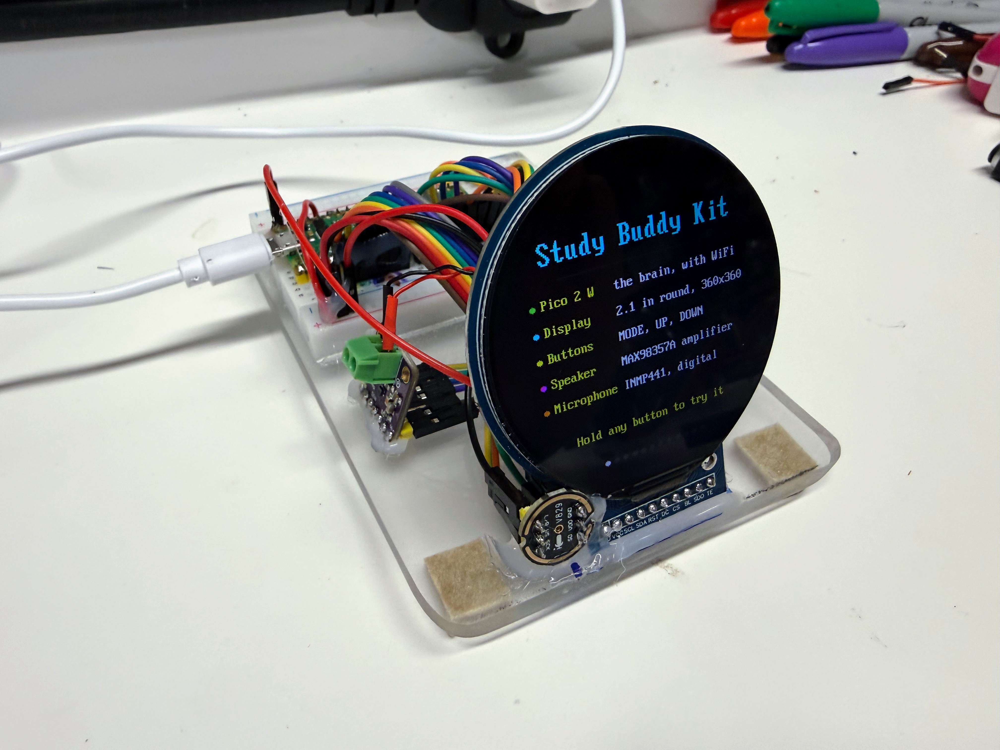
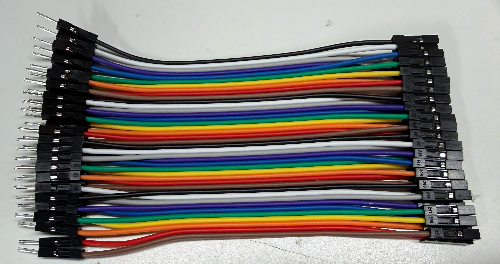
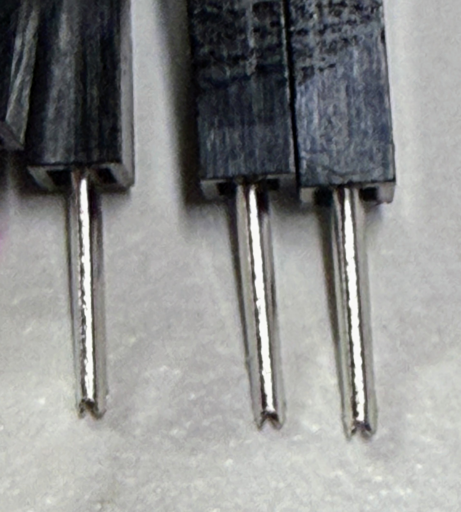
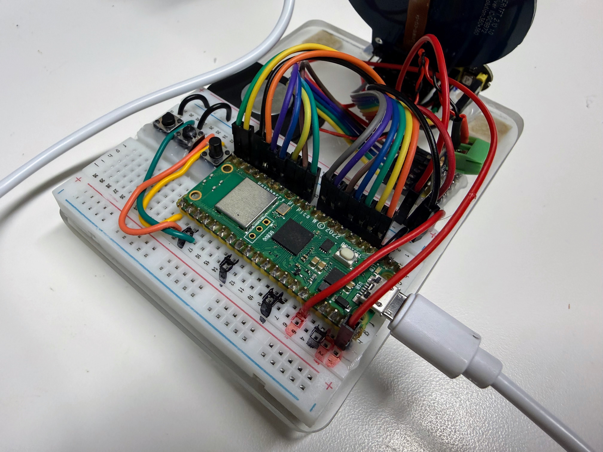
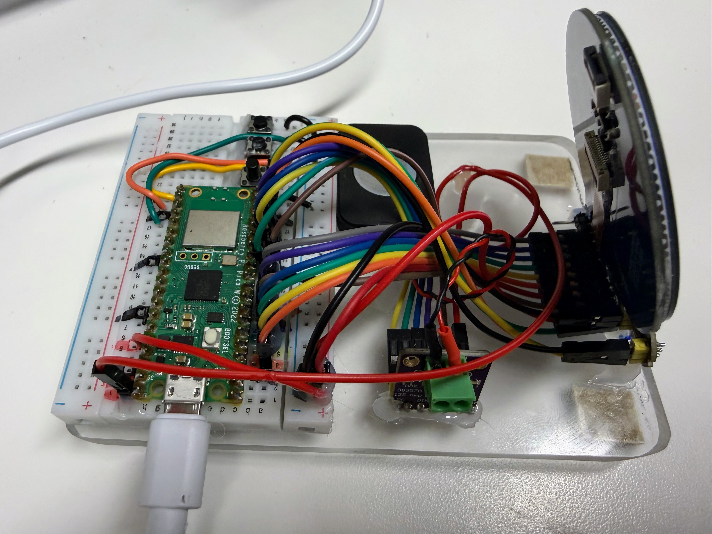

# Wiring Harnesses

The photo above is a sample of our display harness for the large round smartwatch display.  Note the left end is female and is in the same order as the Dupont wire.  The right end is male and only the red power and brown ground wires have been moved.  The ends are hot-glued together to make sure they are all connected in a single block of wire.

!!! mascot-welcome "One Plug Instead of Seven"
    { class="mascot-admonition-img" }
    Loose jumper wires wiggle out of the breadboard, and one loose wire can cost an hour of debugging. In this guide you will turn a ribbon cable into three harnesses that plug in as blocks and land on the right pins every time. Let's listen closely!

A **wiring harness** is a group of wires bundled in a fixed order so they connect as one unit.
This kit needs three: one each for the display, the amplifier, and the microphone. Each
harness is a strip of Dupont wires torn from a 40-wire ribbon cable that has consistent color order. The module end (not the breadboard end) keeps the ribbon's
original color order. At the breadboard Pico end, you move only the few wires that must move, so the block
plugs into the breadboard beside the Pico with its ground wire on a Pico GND pin.  Both ends have a thin strip of hot-glue applied to keep the right pins together to make it easy to plug the harness into the device and the breadboard.

Note that you still **MUST** get the polarity of the wiring harness and the pin alignment correct.

| | |
|---|---|
| **Builds** | Three harnesses: display (8 wires), amplifier (6 wires), microphone (6 wires) |
| **Time** | About 30 minutes for all three |
| **Do it before** | [Lab 04](04-hello-world.md) (display), [Lab 05](05-speaker-tones.md) (amplifier), [Lab 06](06-listen-meter.md) (microphone) |
| **Power** | Unplug the Pico's USB cable while you build and plug in harnesses |

[{ width="600" }](../../img/study-buddy-front-view.jpg)

*The finished kit mounted on a clear acrylic stand with felt feet. All three harnesses run from the breadboard behind the display. Click any photo to see it full size.*

## What You Need

| Item | Notes |
|------|-------|
| A 40-wire **male-to-female** Dupont ribbon cable, **10 cm or 20 cm** | One ribbon makes all three harnesses for one kit. See [Choosing a Wire Length](#choosing-a-wire-length) below. |
| The display, amplifier, and microphone with their header pins soldered on | The female ends of the ribbon push onto these pins. |
| Your Pico 2 W on the breadboard | Pin 1 in breadboard row 1, as in the [circuit diagram](../../chapters/04-pico-kit-hardware/img/circuit-diagram.svg). |
| Optional: hot glue gun, or narrow tape | Holds the male pins together as a block. |
| Optional: a small paper tag for each harness | Write "DISPLAY", "AMP" or "MIC" on it. |

A Dupont **male** end has a pin that pushes into a breadboard hole. A **female** end has a
socket that slides over a module's header pin. In every harness, the female ends go on the
module and the male ends go in the breadboard.

!!! mascot-warning "Check for Forked Pin Tips"
    { class="mascot-admonition-img" }
    Most Dupont male pins are folded from flat sheet metal, so the seam can open into a small fork at the tip. A fork that has spread apart can catch on a breadboard clip or stretch it, leaving the next wire in that hole loose. Before you plug a harness in, gently squeeze any spread tips closed with needle-nose pliers.

### Choosing a Wire Length

Both lengths work, and the steps are the same for each. Pick the one that fits how far your
parts sit from the breadboard.

| Length | Best for | Search for |
|--------|----------|------------|
| 10 cm | **Compact builds**, where the display, amplifier and microphone sit very close to the breadboard and the Pico is oriented with the USB on the left side to shorten the distance. | `dupont jumper wire 40 pin male to female 10cm` |
| 20 cm | **Spreading the parts out**, such as a display on its own stand or a speaker away from the microphone | `dupont jumper wire 40 pin male to female 20cm` (the ribbon in the [Purchasing Guide](../../learning-graph/teachers-guide/index.md#dupont-ribbon-cable-male-to-female-20-cm)) |

Where a step says how far to peel wires apart, it gives the 10 cm length first and the 20 cm
length in parentheses.

### The Ribbon's Color Order

The wires in a Dupont ribbon follow the resistor color code, and the pattern repeats every ten
wires:

**brown, red, orange, yellow, green, blue, purple, gray, white, black**, then brown again.

In all our kits, we try to keep the **red** color connected to the power rail.  This is 3.3 volts for the display and the microphone and 5 volts for the speaker.  You can use 3.3 volts for the speaker but the volume will not be as loud.

Each harness is a strip of neighboring wires taken from this pattern. That is why the colors
below are not random: they are simply where each strip falls on the ribbon. In all three
harnesses, **brown is ground and red is power**.

!!! note "If your ribbon has a different color order"
    Some ribbons use other colors. The method still works: peel a strip of the right length,
    write down its colors in order, and use your own colors in the tables below. What matters
    is the **order** of the wires, not their colors.

### Forked Tip of Make Dupont Connectors

Dupont connectors are noted for their exceptionally low cost.  The get this cost
by stamping the male ends from sheets of metal.  One downside is that the tips
of some Dupont connectors are not a smooth round pin, but have a forked tip.

Be careful when you press the male pins into the breadboard to make sure the tips
do not catch onto the edges of the pins within the breadboard.

## The Big Idea: Every Fifth Row Is Ground

The Pico's left edge has 20 pins, and the breadboard row number equals the Pico's physical pin
number: pin 1 is in row 1, pin 20 in row 20. Four of those pins are **GND**: rows 3, 8, 13 and 18.
They fall every fifth row.

| Rows | Pico pins | Who uses them | GND row inside the block |
|------|-----------|---------------|--------------------------|
| 4 to 10 | GP2, GP3, GP4, GP5, GND, GP6, GP7 | Display | 8 (row 3, also GND, stays empty) |
| 11 | GP8 | Nobody: a one-row gap | |
| 12 to 16 | GP9, GND, GP10, GP11, GP12 | Amplifier | 13 |
| 17 to 20 | GP13, GND, GP14, GP15 | Microphone | 18 |

The kit's pins were chosen so that each module's signal wires sit next to a GND pin. A harness
that keeps its wires in the same order as those rows carries its own ground wire, so plugging
in the block also connects the module's ground. You never need a separate ground wire.  However, the red power wire is removed from breadboard block end.

!!! mascot-thinking "Why the Ground Wire Matters Most"
    { class="mascot-admonition-img" }
    A signal is a voltage *measured against ground*. If a module's GND wire is missing, its signals have nothing to be measured against, and the module fails in confusing ways instead of with a clear error. A harness that carries its own ground makes that mistake much harder.

Power is the exception. The 3.3 V pin (3V3, pin 36) and the 5 V pin (VBUS, pin 40) are on the
Pico's **right** edge, so every red wire leaves its harness and crosses to the right side.

| Red wire from | Goes to | Right-side row |
|---------------|---------|----------------|
| Display VCC | 3V3 (pin 36) | 5 |
| Microphone VDD | 3V3 (pin 36) | 5 |
| Amplifier Vin | VBUS (pin 40), 5 V from USB | 1 |

The microphone is a 3.3 V part, so its red wire must go to 3V3, never VBUS. The amplifier works
on either. It goes to VBUS here because the Pico covers most holes in each breadboard row, which
leaves room for only two wires beside pin 36. If your breadboard has room for three wires in the
3V3 row, the amplifier can use 3V3 instead, as the
[circuit diagram](../../chapters/04-pico-kit-hardware/img/circuit-diagram.svg) shows.

## The Three Rules

1. **Keep the original color order at the module end.** Push the strip's female ends onto the
   module's pins in order, starting with the wire named in each section.
2. **At the Pico end, move only the wires that must move.** Each section lists the moves. Every
   other wire stays next to its neighbor from the ribbon.
3. **Red goes to the right side.** Peel the red wire away from its neighbors along its whole
   length (about 10 cm of a 20 cm wire), so it can reach across the Pico.

To peel a strip, nick the gap between two wires with a fingernail and pull the wires apart
slowly. The wires separate cleanly along their whole length.

## The Wiring Diagram

Each panel shows one harness. The colored squares at the top are the female ends on the module,
in ribbon order. The squares at the bottom are breadboard rows beside the Pico. Click the
diagram to see it larger.

## Harness 1: The Display

The display's header has ten pads: **GND, VCC, SCL, SDA, RST, DC, CS, BL**, then SDO and TE.
Only the first eight get a wire.

### Step 1: Peel an 8-wire strip from brown to gray

Peel a strip of eight wires that starts with **brown** and ends with **gray**: brown, red,
orange, yellow, green, blue, purple, gray. These are the display colors used in `config.py`.

### Step 2: Plug the female ends onto the display

Push the strip onto the display's first eight pads, with **brown on GND**. Red then lands on
VCC, orange on SCL, and so on down to gray on BL. SDO and TE stay bare.

### Step 3: Make two changes at the Pico end

1. **Pull red out.** Peel the red wire away from brown and orange along its whole length (about
   10 cm on 20 cm wires). It goes to 3V3 on the right side.
2. **Move brown between blue and purple.** With red gone, brown is free at the Pico end. Peel
   purple away from blue for about 3 cm (5 cm), lay brown across the other wires, and put it in
   the gap. Row 8 is a Pico GND pin, so brown lands on ground in the middle of the block.

### Step 4: Plug it into the breadboard

Rear view of the Open Study Buddy with the USB connector on the lower right.  Row 1 of the breadboard is on the right in this view.  The orange wire on the display harness is in row 4.

| Wire | Display pin | Breadboard row | Pico pin |
|------|-------------|----------------|----------|
| (none) | | 3 | GND, left empty |
| orange | SCL | 4 | GP2 |
| yellow | SDA | 5 | GP3 |
| green | RST | 6 | GP4 |
| blue | DC | 7 | GP5 |
| brown | GND | 8 | GND |
| purple | CS | 9 | GP6 |
| gray | BL | 10 | GP7 |
| red | VCC | 5, right side | 3V3 (pin 36) |

All seven wires form one block in rows 4 to 10, with brown in the middle on row 8, as in the
photo at the top of this page. Row 3 is also a GND pin, but the display needs only one ground,
so it stays empty. Check it with [Lab 04](04-hello-world.md): "Hello World!" should appear inside a
cyan ring.

## Harness 2: The Amplifier

The MAX98357A's header has seven pins: **LRC, BCLK, DIN, GAIN, SD, GND, Vin**. SD (shutdown) is
not used.

### Step 1: Peel a 7-wire strip from blue to red

Peel a strip of seven wires that starts with **blue** and ends with **red**: blue, purple, gray,
white, black, brown, red. This strip crosses the place where the color pattern starts over,
which is how brown and red end up on GND and Vin.

### Step 2: Remove the black wire

The black wire lines up with SD. Peel it off the strip completely and set it aside. You now
have a strip of four (blue, purple, gray, white) and a pair (brown, red).

!!! mascot-warning "SD Must Never Go to Ground"
    { class="mascot-admonition-img" }
    Pulling the amplifier's SD pin to ground switches the amplifier off, so a black wire from SD plugged into a GND row gives you a silent speaker and no error. Leave SD with no wire at all; the board's own resistor keeps the amplifier on.

### Step 3: Plug the female ends onto the amplifier

Push the four-wire strip onto LRC, BCLK, DIN and GAIN, with **blue on LRC**. Leave SD bare. Push
the pair onto GND and Vin, with **brown on GND** and red on Vin.

### Step 4: Make two changes at the Pico end

The amplifier lists LRC before BCLK, but MicroPython needs BCLK on the lower pin, with LRC on the
pin right after it. The ground pin sits between them on the Pico.

1. **Swap blue and purple.** Peel blue and purple apart for about 3 cm (5 cm) and cross them, so purple
   (BCLK) comes first.
2. **Put brown between them.** Bring the brown GND wire over to sit between purple and blue.

Red goes to VBUS on the right side.

### Step 5: Plug it into the breadboard

| Wire | Amplifier pin | Breadboard row | Pico pin |
|------|---------------|----------------|----------|
| purple | BCLK | 12 | GP9 |
| brown | GND | 13 | GND |
| blue | LRC | 14 | GP10 |
| gray | DIN | 15 | GP11 |
| white | GAIN | 16 | GP12 |
| red | Vin | 1, right side | VBUS (pin 40) |

The five wires form one block in rows 12 to 16. Gray and white never move: they are still
neighbors from the ribbon. Check it with [Lab 05](05-speaker-tones.md): you should hear a beep,
a scale, and three volumes.

## Harness 3: The Microphone

The INMP441 board has two rows of three pins. With the board's label facing you, the top row is
**SCK, WS, L/R** and the bottom row is **SD, VDD, GND**, with GND under L/R.

### Step 1: Peel a 6-wire strip from gray to orange

Peel a strip of six wires that starts with **gray** and ends with **orange**: gray, white,
black, brown, red, orange.

### Step 2: Fold the strip around the two pin rows

Split the strip between black and brown for about 2 cm (3 cm), so it can bend into a U.

1. Push the first three wires onto the top row, left to right: **gray on SCK**, white on WS,
   black on L/R.
2. Fold the strip down around the right edge of the board. The next three wires go onto the
   bottom row, right to left: **brown on GND**, red on VDD, orange on SD.

The order never changes. The strip simply wraps around the board, so brown (GND) sits right
under black (L/R).

### Step 3: Make two changes at the Pico end

1. **Pull red out.** Peel it away along its whole length (about 10 cm on 20 cm wires). It goes to 3V3 on the right side.
2. **Move white past black and brown.** On the Pico, the ground pin comes between SCK and WS, so
   white (WS) moves down one place. Black and brown both go in the ground row, side by side.
   L/R tied to ground tells the microphone to send the left channel, which is what the kit
   reads.

### Step 4: Plug it into the breadboard

| Wire | Microphone pin | Breadboard row | Pico pin |
|------|----------------|----------------|----------|
| gray | SCK | 17 | GP13 |
| brown | GND | 18 | GND |
| black | L/R | 18 (the next hole out) | GND |
| white | WS | 19 | GP14 |
| orange | SD | 20 | GP15 |
| red | VDD | 5, right side | 3V3 (pin 36) |

Check it with [Lab 06](06-listen-meter.md): the meter should move when you talk.

## Finishing the Harnesses

Once a harness works, lock its Pico end in place so it plugs in as one block every time:

- **Hot Glue it.** Line the male pins up in a spare row of the breadboard with the same spacing they
  will have beside the Pico, then put a thin bead of hot glue across the plastic housings, not
  the metal pins. Let it cool before you pull the block out.
- **Or tape it.** A narrow wrap of tape around the housings works too, and is easier to undo.
- **Label it.** Tape a tag to each harness. A harness with "MIC" on it can't be swapped with the
  amplifier's by mistake.

[{ width="600" }](../../img/study-buddy-rear-view.jpg)

*Rear view: each harness ends in a block of black housings glued together, plugged in beside the
Pico. The red power wires leave their blocks and cross to the other side.*

!!! mascot-tip "Hot Glue the Blocks You Built"
    { class="mascot-admonition-img" }
    Hot glue the display as one block of seven (rows 4 to 10), the amplifier as one block of five, and the microphone as one block of four plus the black wire. Leave every red wire loose so it can reach the right side.

## Check Before You Power On

Unplug the USB cable, then check each harness against its table:

1. Each **brown** wire is in a GND row: 8, 13 or 18.
2. Each **red** wire is on the right side: display and microphone in row 5 (3V3), the amplifier
   in row 1 (VBUS). The microphone's red wire is **not** in row 1.
3. Row 3 is empty, and row 11 is empty.
4. The amplifier's SD pin has no wire.
5. Every wire is pushed all the way into its hole.

[{ width="600" }](../../img/study-buddy-side-view.jpg)

*Side view: the ribbons run from the blocks beside the Pico to the amplifier (center, with the
green speaker terminal) and the display (right).*

Then plug in the USB cable and run [Lab 02, the hardware probe](02-probe.md). It checks the pin
plan and the parts it can see, and reports any wiring that breaks the rules.

!!! mascot-celebration "Three Harnesses, Zero Loose Wires"
    { class="mascot-admonition-img" }
    You turned a flat ribbon into three harnesses that each carry their own ground and plug in as blocks. Now a module comes off and goes back on in seconds, and the wires stay in order every time.
