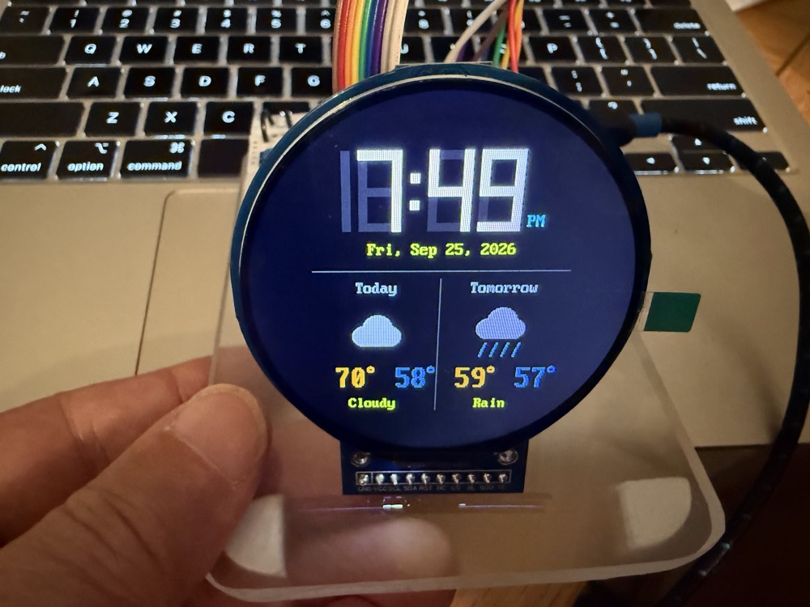
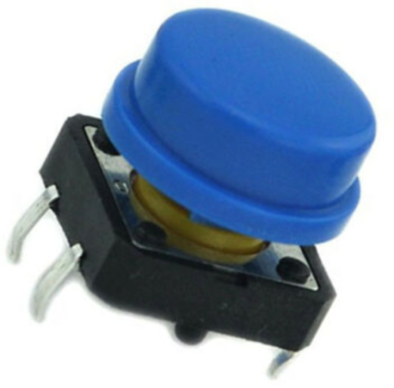
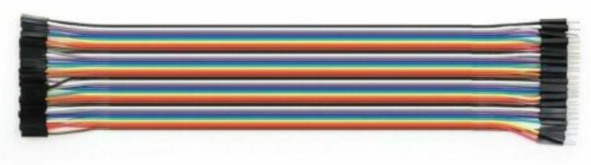
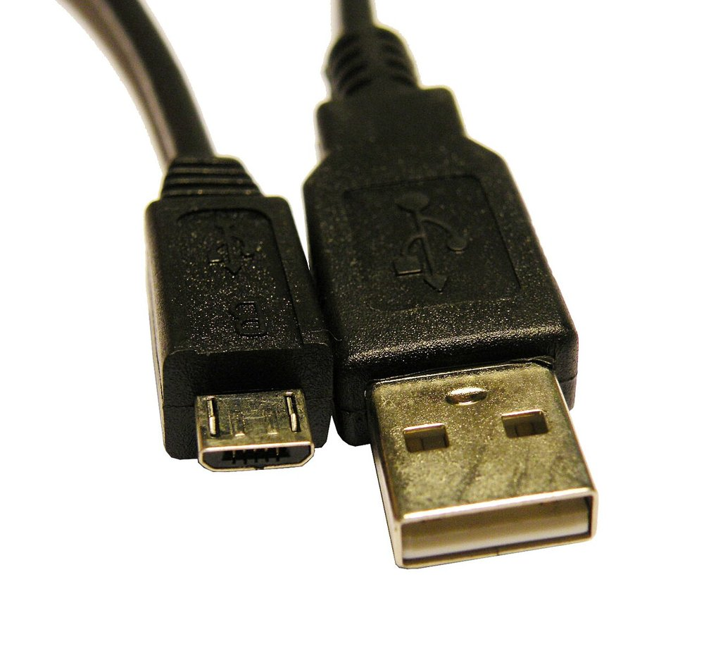

# Teacher's Guide

This page holds the Purchasing Guide section of the Teacher's Guide for Open Study Buddy.

## Purchasing Guide

{ width="450" }

The whole book runs on one kit, the **Study Buddy base kit**: a Raspberry Pi Pico 2 WH, a
2.1-inch 360×360 round color display (GC9B72), an INMP441 I²S microphone, a MAX98357A I²S
amplifier with a small speaker, three push buttons, a breadboard and wiring. One kit costs about
**$28** at single-unit prices and about **$21 per student** for a class of 20. Every part except
the Pico ships from China in **8–12 days (median 9)** in our 2026 AliExpress orders, so order at
least three weeks before the hardware chapters start, and four to five weeks ahead for a full
classroom set.

!!! note "Prices checked October 2026"
    Component prices move, and marketplace listings turn over constantly. Treat every figure
    here as a planning estimate, not a quote. Each part shows the **low and high AliExpress
    prices** we found in web searches on October 20, 2026, with eBay and Amazon prices for
    comparison. Figures marked *estimate* could not be confirmed from a current listing, and each
    one says why.

!!! warning "Don't order the wrong one: a 360×360 SPI display with the GC9B72 controller"
    The kit's driver (`lib/gc9b72.py`) only works with the **2.1-inch, 360×360, 4-wire SPI**
    round display built on the **GC9B72** controller. Marketplaces list 2.1-inch round **480×480**
    panels (ST7701, RGB or MIPI interface) and 1.28-inch **GC9A01** round displays right beside
    it, with nearly identical photos. Neither will work. Look for "GC9B72" and "360x360" in the
    listing title.

### Summary of Parts List

**Required**

- [Raspberry Pi Pico 2 WH](#raspberry-pi-pico-2-wh) — runs MicroPython and connects to Wi-Fi — Study Buddy base kit (~$6.99)
- [2.1-inch Round Display (GC9B72, 360x360)](#21-inch-round-display-gc9b72-360x360) — the buddy's face — Study Buddy base kit (~$6.12)
- [INMP441 I2S Microphone](#inmp441-i2s-microphone) — the buddy's ear — Study Buddy base kit (~$3.00)
- [MAX98357A I2S Amplifier](#max98357a-i2s-amplifier) — drives the speaker from digital audio — Study Buddy base kit (~$1.53)
- [Speaker (3525, 8 ohm, 2 W)](#speaker-3525-8-ohm-2-w) — the buddy's voice — Study Buddy base kit (~$1.09)
- [Momentary Push Buttons (6x6 mm)](#momentary-push-buttons-6x6-mm) — Mode, Up and Down — Study Buddy base kit (~$0.15 for three)
- [Solderless Breadboard (830 Point)](#solderless-breadboard-830-point) — holds everything — Study Buddy base kit (~$2.00)
- [Male-to-Male Jumper Wires](#male-to-male-jumper-wires) — breadboard links — Study Buddy base kit (~$2.00)
- [Dupont Ribbon Cable (Male-to-Female, 20 cm)](#dupont-ribbon-cable-male-to-female-20-cm) — the display cable — Study Buddy base kit (~$2.95)
- [Micro-USB Data Cable](#micro-usb-data-cable) — power and the Thonny connection — Study Buddy base kit (~$2.50)

**Optional**

None. Every part above is used by the kit's tests, and the base kit has no battery, enclosure
or SD card yet.

**Price ranges and lead times at a glance:**

| Part | Qty | Price range | AliExpress lead time |
|------|-----|-------------|----------------------|
| Raspberry Pi Pico 2 WH | 1 | AliExpress $3.53–$31.09 (genuine "original" boards $20.75); eBay ~$15–$23; Amazon $13.99 (no headers)–$18.95 (WH); **Micro Center $6.99** | Not recommended from AliExpress. Micro Center: same-day pickup, or ships in 5–7 business days |
| 2.1-inch round display (GC9B72) | 1 | AliExpress $5.39–$6.12; eBay ~$8–$15 *(estimate)*; Amazon: no matching listing found | 8–12 days (median 9). Glass panel, so allow for a breakage spare |
| INMP441 microphone | 1 | AliExpress $0.99–$4.39; eBay ~$3–$8; Amazon $8.54–$9.99 per 3-pack ($2.85–$3.33 each) | 8–12 days (median 9) |
| MAX98357A amplifier | 1 | AliExpress $0.93–$1.53; eBay ~$2–$6 *(estimate)*; Amazon $6.88 per 2-pack to $11.99 per 6-pack ($2.00–$3.44 each) | 8–12 days (median 9) |
| Speaker, 3525 8 Ω 2 W | 1 | AliExpress $0.58–$2.80; eBay $1.47 + $3.50 shipping; Amazon $12.99 per 10-pack ($1.30 each) | 8–12 days (median 9). Small sealed speaker, no magnet or battery shipping rules |
| 6×6 mm push buttons | 3 | AliExpress ~$0.01–$0.03 each in 100-packs *(estimate)*; eBay ~$3–$6 per 100 *(estimate)*; Amazon $4.99 per 100 | 8–12 days (median 9) |
| 830-point breadboard | 1 | AliExpress $0.68–$2.61; eBay ~$2–$7 *(estimate)*; Amazon $19.99 per 10-pack ($2.00 each) | 8–12 days (median 9). Bulky for its weight: ten boards ship as a larger parcel |
| Male-to-male jumper set | 1 set | AliExpress/eBay/Amazon 65-piece sets $1.99–$5.50 | 8–12 days (median 9) |
| Dupont ribbon, 40-wire M-F 20 cm | 8 wires | AliExpress from ~$0.99; eBay ~$2–$4 *(estimate)*; PiShop US $2.95 | 8–12 days (median 9) |
| Micro-USB data cable | 1 | AliExpress ~$0.80–$2.00 *(estimate)*; eBay ~$2–$4 *(estimate)*; Amazon $7.49–$9.44 per 3-pack ($2.50–$3.15 each) | 8–12 days (median 9), or buy on Amazon |

**Estimated total per kit:**

| Kit | One kit | Per student, class of 20 |
|-----|---------|--------------------------|
| Study Buddy base kit | ~$28.33 | ~$21.12 |

The one-kit figure uses each part's single-unit price. If you are building just one kit, the real
out-of-pocket cost is higher (about $40) because buttons, cables and breadboards come in packs.
The class figure rounds each order up to the pack, and the Pico 2 WH stays at its fixed $6.99
retail price at any quantity.

### Raspberry Pi Pico 2 WH

<!-- TODO: image needed — see pico-2-w-image-description.md -->
*Photo pending. See the [image brief](./pico-2-w-image-description.md).*

**Used in:** Study Buddy base kit (×1)

**Used for:** [Chapter 4: The Pico Kit Hardware and Wiring](../../chapters/04-pico-kit-hardware/index.md)
and every chapter after it, including Wi-Fi in
[Chapter 13: Wi-Fi, HTTP, and Connecting to the Agent](../../chapters/13-wifi-http-agent-link/index.md).
It runs the student's MicroPython and talks to every other part.

The Pico 2 W is Raspberry Pi's RP2350 microcontroller board with 2.4 GHz Wi-Fi and Bluetooth.
Buy the **WH** version, which has its header pins already soldered so it drops straight into the
breadboard. The plain "Pico 2 W" has bare pads.

**Requirements:** It must be a **Pico 2 W (RP2350)**. The older Pico W (RP2040) and the plain
Pico 2 (no Wi-Fi) look almost the same in listing photos. The book's audio, FFT and Wi-Fi
chapters assume the RP2350's 520 KB of RAM and the wireless chip. The radio is 2.4 GHz only, so
confirm with your school's IT team that a 2.4 GHz network is available.

**Prep work:** None for the WH. A plain Pico 2 W needs its headers soldered on (about 15
minutes).

**Cost:** ~$6.99 each in quantity 1 (Micro Center "Pico 2W with Header", SC1634) · ~$6.99 each in
a classroom order of 20+ · ~$6.99 at district scale (*estimate*: we assume the fixed retail price
holds). **Price range:** AliExpress $3.53–$31.09 (the low end is a promotional listing of
uncertain origin; listings titled "100% New Original" were $20.75); eBay about US$15–$23 (eBay
Australia listings at AU$23.75–AU$34.98; we could not load US eBay results); Amazon $13.99 for
the Pico 2 W without headers and $18.95 for a pre-soldered version.

**AliExpress lead time:** Not recommended. Marketplace Picos cost two to four times the Micro
Center price and are the boards most likely to be relabeled. Micro Center stores have it the same
day, and its online store lists "usually ships in 5–7 business days".

**Trusted sellers:** Micro Center, Adafruit, SparkFun, Digi-Key and PiShop.us. Genuine boards say
"Pico 2 W" on the silkscreen and carry an RP2350 chip.

**Search keywords:** `Raspberry Pi Pico 2 WH`, `Pico 2 W with header`, `SC1634`

**Where to buy:**

- [Search eBay for "Raspberry Pi Pico 2 WH"](https://www.ebay.com/sch/i.html?_nkw=Raspberry+Pi+Pico+2+WH)
- [Search AliExpress for "Raspberry Pi Pico 2 WH"](https://www.aliexpress.com/w/wholesale-raspberry-pi-pico-2-wh.html)
- [Search Amazon for "Raspberry Pi Pico 2 WH"](https://www.amazon.com/s?k=Raspberry+Pi+Pico+2+WH)
- [Search Micro Center for "Raspberry Pi Pico 2 WH"](https://www.microcenter.com/search/search_results.aspx?Ntt=Raspberry+Pi+Pico+2+WH)

---

### 2.1-inch Round Display (GC9B72, 360x360)

{ width="400" }

**Used in:** Study Buddy base kit (×1)

**Used for:** [Chapter 5: Display Basics: Pixels, Color, and Frame Size](../../chapters/05-display-basics/index.md) and
[Chapter 6: Drawing Directly to Display Regions](../../chapters/06-display-regions-and-drawing/index.md),
then the face, text and level meter in every later chapter.

A 2.1-inch round IPS color screen with 360×360 pixels and a GC9B72 controller, driven over 4-wire
SPI at 3.3 V. The module has a 10-pin header (GND, VCC, SCL, SDA, RST, DC, CS, BL, SDO, TE). The
kit uses the first eight. GalaxyCore has never published a GC9B72 datasheet, so the book's
driver was ported from the one known-good public init sequence. That makes the exact controller
matter more than usual.

**Requirements:** It must say **GC9B72**, **360x360** and **SPI**. The 480×480 2.1-inch round
panels need an RGB or MIPI interface that the Pico does not have.

**Prep work:** None. The header comes soldered. Peel off an 8-wire strip of the ribbon cable for
it (see below).

**Cost:** ~$6.12 in quantity 1 (the AliExpress listing we bought from, US$6.12) · ~$5.39 each in a
classroom order of 20+ (the lowest current AliExpress search price) · no district tier found.
**Price range:** AliExpress $5.39–$6.12 (TZT's own store lists it at $3.45); eBay ~$8–$15
(*estimate*: we could not load current US eBay results); Amazon: no matching 360×360 GC9B72
listing found, only the 480×480 panels that will not work. A European marketplace lists it at
€14.64 plus shipping.

**AliExpress lead time:** 8–12 days (median 9), the same as our other AliExpress packages. The
glass panel ships in a bigger padded box, and a cracked screen means reordering and another 9
days, so buy one or two spares.

**Spotting a bad batch:** A blank screen with the backlight on usually means a wiring mistake, so
run test 04 first. A panel with a dead line or a dark sector after a correct test is a defect.
Set it aside and use a spare.

**Search keywords:** `GC9B72 2.1 inch round display 360x360`, `2.1 inch round TFT SPI GC9B72`

**Where to buy:**

- [Search eBay for "GC9B72 2.1 inch round display 360x360"](https://www.ebay.com/sch/i.html?_nkw=GC9B72+2.1+inch+round+display+360x360)
- [Search AliExpress for "GC9B72 2.1 inch round display 360x360"](https://www.aliexpress.com/w/wholesale-gc9b72-2-1-inch-round-display-360x360.html)
- [Search Amazon for "GC9B72 2.1 inch round display 360x360"](https://www.amazon.com/s?k=GC9B72+2.1+inch+round+display+360x360)

---

### INMP441 I2S Microphone

{ width="350" }

**Used in:** Study Buddy base kit (×1)

**Used for:** [Chapter 8: I2S Audio: Recording and Playing Sound](../../chapters/08-i2s-audio/index.md),
[Chapter 11: Microphone Calibration and Push-to-Talk](../../chapters/11-mic-calibration-push-to-talk/index.md)
and [Chapter 12: Wake-Word Detection](../../chapters/12-wake-word-detection/index.md). It turns the
student's voice into 24-bit samples.

A digital MEMS microphone with its own ADC, sending samples straight to the Pico over I²S. Buy
the **INMP441** by name. The "INMP441-compatible" MS3625 and MS4030 boards are cheaper, but the
kit's calibration numbers were measured on the INMP441. It is a 3.3 V part: VDD goes to 3V3, never
to VBUS.

**Prep work:** Some minor soldering required. Most listings ship with the six-pin header
**loose**, as in the photo, and soldering it takes about 5 minutes per board. Listings sold as
"solderless" have the header fitted and are worth the extra few cents for a no-solder kit. Tie
the L/R pin to GND.

**Cost:** ~$3.00 in quantity 1 (AliExpress singles at $2.19–$4.39) · ~$1.00 each in a classroom
order of 20+ (AliExpress listings around $0.99) · ~$0.89 each at district scale (an Alibaba tiered
listing at $0.89 for 10–999 pieces). **Price range:** AliExpress $0.99–$4.39 (coin-deal listings
as low as $0.33 are for new shoppers only); eBay ~$3–$8 (UK listings at £5.82–£5.99, Germany
€2.28 plus €1.60 shipping); Amazon $8.54–$9.99 per 3-pack.

**AliExpress lead time:** 8–12 days (median 9).

**Spotting a bad batch:** A dead or badly soldered microphone reads as all zeros, which looks
exactly like the swapped-wire fault in the kit README. Check the wiring, then the solder joints,
then swap in a spare.

**Search keywords:** `INMP441 I2S microphone module`, `INMP441 MEMS omnidirectional`,
`INMP441 solderless`

**Where to buy:**

- [Search eBay for "INMP441 I2S microphone module"](https://www.ebay.com/sch/i.html?_nkw=INMP441+I2S+microphone+module)
- [Search AliExpress for "INMP441 I2S microphone module"](https://www.aliexpress.com/w/wholesale-inmp441-i2s-microphone-module.html)
- [Search Amazon for "INMP441 I2S microphone module"](https://www.amazon.com/s?k=INMP441+I2S+microphone+module)
- [Search Alibaba for "INMP441 I2S microphone module"](https://www.alibaba.com/trade/search?SearchText=INMP441+I2S+microphone+module)

---

### MAX98357A I2S Amplifier

<!-- TODO: image needed — see max98357a-amplifier-image-description.md -->
*Photo pending. See the [image brief](./max98357a-amplifier-image-description.md).*

**Used in:** Study Buddy base kit (×1)

**Used for:** [Chapter 7: Buttons, State Machines, and Device Modes](../../chapters/07-buttons-and-device-modes/index.md)
(the volume beep) and [Chapter 8: I2S Audio: Recording and Playing Sound](../../chapters/08-i2s-audio/index.md), then every
chapter where the buddy speaks. It turns I²S audio from the Pico into power for the speaker.

A digital-to-analog converter and a 3 W class-D amplifier on one small board, with seven pins
(LRC, BCLK, DIN, GAIN, SD, GND, VIN) and a two-screw output terminal. The kit drives its GAIN pin
from GP18 so software can pick 6, 9 or 12 dB. Buy the mono **MAX98357A** breakout, not the
analog PAM8403 boards or the larger stereo TDM boards that show up in the same searches.

**Prep work:** Some minor soldering required on most listings. The seven-pin header and the
screw terminal usually ship loose, which takes about 10 minutes per board. Some listings are sold
as "pre-soldered" for about the same price, and we recommend those for a no-solder kit.

**Cost:** ~$1.53 in quantity 1 · ~$0.99 each in a classroom order of 20+ (most AliExpress
listings) · no district tier found. **Price range:** AliExpress $0.93–$1.53 (pre-soldered
listings about $0.99); eBay ~$2–$6 (*estimate*: we could not load current US eBay results;
Adafruit's genuine breakout is $5.95); Amazon $6.88 for a 2-pack, $7.59 for 3, $8.54 for 4 and
$11.99 for 6 ($2.00–$3.44 each).

**AliExpress lead time:** 8–12 days (median 9).

**Spotting a bad batch:** No sound with test 05 is almost always the I²S pin rule (LRC must be
the pin right after BCLK) or a loose screw terminal. If test 02 reports no warnings and the
speaker is known good, swap the board.

**Search keywords:** `MAX98357A I2S amplifier module`, `MAX98357 I2S 3W class D pre-soldered`

**Where to buy:**

- [Search eBay for "MAX98357A I2S amplifier module"](https://www.ebay.com/sch/i.html?_nkw=MAX98357A+I2S+amplifier+module)
- [Search AliExpress for "MAX98357A I2S amplifier module"](https://www.aliexpress.com/w/wholesale-max98357a-i2s-amplifier-module.html)
- [Search Amazon for "MAX98357A I2S amplifier module"](https://www.amazon.com/s?k=MAX98357A+I2S+amplifier+module)

---

### Speaker (3525, 8 ohm, 2 W)

<!-- TODO: image needed — see speaker-3525-image-description.md -->
*Photo pending. See the [image brief](./speaker-3525-image-description.md).*

**Used in:** Study Buddy base kit (×1)

**Used for:** [Chapter 8: I2S Audio: Recording and Playing Sound](../../chapters/08-i2s-audio/index.md) and every chapter
where the buddy beeps, plays back a recording or speaks.

A small sealed "3525" cavity speaker, 35 × 25 mm, with a red and black lead ending in a 2-pin JST
PH 2.0 plug. The kit's speaker is the **8 Ω, 2 W** version: it was measured at 7.4 Ω DC
resistance. The same listings also sell a 4 Ω, 3 W version. Either works with the MAX98357A,
but the 8 Ω one is quieter and draws less current from the Pico's USB supply, so stay with it.

**Prep work:** About 2 minutes. Cut off the JST plug, strip 5 mm from each wire, and clamp the
wires in the amplifier's screw terminal (red to +).

**Cost:** ~$1.09 in quantity 1 · ~$0.58 each in a classroom order of 20+ (the lowest current
AliExpress search price) · no district tier found for this exact speaker. **Price range:**
AliExpress $0.58–$2.80 (the $2.80 listing is the one the prototype kit came from); eBay $1.47
plus $3.50 shipping (a UK listing); Amazon $12.99 for a 10-pack ($1.30 each).

**AliExpress lead time:** 8–12 days (median 9). The speaker is small and has no battery, so it
ships like any other small packet.

**Search keywords:** `3525 speaker 8 ohm 2W`, `3525 cavity speaker JST PH2.0`

**Where to buy:**

- [Search eBay for "3525 speaker 8 ohm 2W"](https://www.ebay.com/sch/i.html?_nkw=3525+speaker+8+ohm+2W)
- [Search AliExpress for "3525 speaker 8 ohm 2W"](https://www.aliexpress.com/w/wholesale-3525-speaker-8-ohm-2w.html)
- [Search Amazon for "3525 speaker 8 ohm 2W"](https://www.amazon.com/s?k=3525+speaker+8+ohm+2W)

---

### Momentary Push Buttons (6x6 mm)

{ width="250" }

**Used in:** Study Buddy base kit (×3: Mode, Up and Down)

**Used for:** [Chapter 7: Buttons, State Machines, and Device Modes](../../chapters/07-buttons-and-device-modes/index.md)
and push-to-talk in [Chapter 11](../../chapters/11-mic-calibration-push-to-talk/index.md).

Standard 6×6 mm, four-leg, through-hole tactile switches. Each one connects GP13, GP14 or GP15 to
GND and uses the Pico's internal pull-up, so no resistor is needed. Colored caps are optional but
help students tell Mode from Up and Down.

**Prep work:** None. They are breadboard-ready as shipped. Show students that the four legs are
two connected pairs, so a button wired with both wires on the same side reads "pressed" all the
time.

**Cost:** ~$0.15 for three in quantity 1 (a 100-pack is $4.99 on Amazon) · ~$0.05 each in a
classroom order of 20+ (one 100-pack covers 20 kits with 40 spares) · ~$0.04 each at district
scale (Alibaba switches at a 1,000-piece minimum order). **Price range:** AliExpress ~$0.01–$0.03
each in 100-packs (*estimate*: not re-checked this month); eBay ~$3–$6 per 100 (*estimate*);
Amazon $4.99 per 100.

**AliExpress lead time:** 8–12 days (median 9).

**Spotting a bad batch:** Legs bent too short to seat, or switches that never click. Discard the
odd bad one; the 100-pack has plenty of spares.

**Search keywords:** `6x6mm tactile push button 4 pin`, `tact switch 6x6x5 DIP`

**Where to buy:**

- [Search eBay for "6x6mm tactile push button 4 pin"](https://www.ebay.com/sch/i.html?_nkw=6x6mm+tactile+push+button+4+pin)
- [Search AliExpress for "6x6mm tactile push button 4 pin"](https://www.aliexpress.com/w/wholesale-6x6mm-tactile-push-button-4-pin.html)
- [Search Amazon for "6x6mm tactile push button 4 pin"](https://www.amazon.com/s?k=6x6mm+tactile+push+button+4+pin)
- [Search Alibaba for "6x6mm tactile push button 4 pin"](https://www.alibaba.com/trade/search?SearchText=6x6mm+tactile+push+button+4+pin)

---

### Solderless Breadboard (830 Point)

{ width="450" }

*Photo: oomlout, [CC BY-SA 2.0](https://creativecommons.org/licenses/by-sa/2.0) via [Wikimedia Commons](https://commons.wikimedia.org/wiki/File:BREB-02_(14335226011).jpg)*

**Used in:** Study Buddy base kit (×1)

**Used for:** [Chapter 4: The Pico Kit Hardware and Wiring](../../chapters/04-pico-kit-hardware/index.md)
and every wired test after it.

A full-size 830 tie-point breadboard ("MB-102"). Buy the full size: the Pico, microphone,
amplifier and three buttons do not fit on a 400-point half-size board, and the chapter's advice
to keep the microphone's wires away from the amplifier's needs the room.

**Prep work:** None. Optionally mark the 3V3 and GND rails with a permanent marker; the
microphone is damaged by 5 V.

**Cost:** ~$2.00 in quantity 1 (an Amazon 10-pack at $19.99) · ~$1.10 each in a classroom order
of 20+ · ~$0.40 each at district scale (Alibaba listings at $0.40 for 5–49 pieces, plus a flat
shipping charge). **Price range:** AliExpress $0.68–$2.61 (most around $0.99–$1.21); eBay ~$2–$7
(*estimate*; a single board is $6.94 from Circuit Specialists); Amazon $19.99 per 10-pack.

**AliExpress lead time:** 8–12 days (median 9). Breadboards are light but bulky, so a 20-board
order arrives as a larger parcel. Some sellers split it into several packages that arrive on
different days.

**Spotting a bad batch:** A rail or row clip that is not bent properly, so wires will not seat.
Test each board with a jumper on arrival and throw out the odd bad one.

**Search keywords:** `830 point solderless breadboard`, `MB-102 breadboard`

**Where to buy:**

- [Search eBay for "830 point solderless breadboard"](https://www.ebay.com/sch/i.html?_nkw=830+point+solderless+breadboard)
- [Search AliExpress for "830 point solderless breadboard"](https://www.aliexpress.com/w/wholesale-830-point-solderless-breadboard.html)
- [Search Amazon for "830 point solderless breadboard"](https://www.amazon.com/s?k=830+point+solderless+breadboard)
- [Search Alibaba for "830 point solderless breadboard"](https://www.alibaba.com/trade/search?SearchText=830+point+solderless+breadboard)

---

### Male-to-Male Jumper Wires

{ width="400" }

**Used in:** Study Buddy base kit (×1 set)

**Used for:** [Chapter 4](../../chapters/04-pico-kit-hardware/index.md): power and ground rails,
the buttons, and the microphone and amplifier wiring on the breadboard.

A mixed-length set of male-to-male jumpers. The kit needs about 20 wires, so a 65-piece set
leaves spares.

**Prep work:** None.

**Cost:** ~$2.00 per set in quantity 1 · ~$2.00 per set in a classroom order of 20+ · ~$1.00 per
set at district scale (*estimate*: no current bulk listing found). **Price range:** 65-piece sets
at $1.99–$5.50 across AliExpress, eBay and Amazon (October 2026 checks for our FFT kit; not
re-checked per site).

**AliExpress lead time:** 8–12 days (median 9).

**Spotting a bad batch:** Pin ends that wobble in their crimp cause intermittent faults that look
like code bugs. Throw out any jumper whose tip moves.

**Search keywords:** `breadboard jumper wires male to male`, `65 pcs jumper wire kit`

**Where to buy:**

- [Search eBay for "breadboard jumper wires male to male"](https://www.ebay.com/sch/i.html?_nkw=breadboard+jumper+wires+male+to+male)
- [Search AliExpress for "breadboard jumper wires male to male"](https://www.aliexpress.com/w/wholesale-breadboard-jumper-wires-male-to-male.html)
- [Search Amazon for "breadboard jumper wires male to male"](https://www.amazon.com/s?k=breadboard+jumper+wires+male+to+male)

---

### Dupont Ribbon Cable (Male-to-Female, 20 cm)

{ width="450" }

**Used in:** Study Buddy base kit (×8 wires, one-fifth of a 40-wire ribbon)

**Used for:** The display cable in [Chapter 5: Display Basics: Pixels, Color, and Frame Size](../../chapters/05-display-basics/index.md).

A 40-wire ribbon of Dupont jumpers with a female socket on one end and a male pin on the other.
Peel off an 8-wire strip for the display: the female ends push onto the display's header and the
male ends go into the breadboard. `config.py` records a color for each display wire (SCL orange,
SDA yellow, RST green, DC blue, CS purple, BL gray, VCC red), so peel the strip where those colors
line up. One ribbon makes cables for five kits.

**Prep work:** Peel the ribbon into 8-wire strips, about 1 minute per kit. Keep the strip intact:
it stays in pin order and is far harder to miswire than loose jumpers.

**Cost:** ~$2.95 per ribbon in quantity 1 (PiShop US) · ~$1.00 per ribbon in a classroom order of
20+ (AliExpress from about $0.99), about $0.20 per kit · ~$0.65 per ribbon at district scale (an
Alibaba listing). **Price range:** AliExpress from ~$0.99; eBay ~$2–$4 (*estimate*); PiShop $2.95.

**AliExpress lead time:** 8–12 days (median 9).

**Spotting a bad batch:** Female sockets too loose to grip a header pin. Test-fit one strip on
the display when the order arrives.

**Search keywords:** `dupont jumper wire 40 pin male to female 20cm`, `M-F dupont ribbon cable`

**Where to buy:**

- [Search eBay for "dupont jumper wire 40 pin male to female 20cm"](https://www.ebay.com/sch/i.html?_nkw=dupont+jumper+wire+40+pin+male+to+female+20cm)
- [Search AliExpress for "dupont jumper wire 40 pin male to female 20cm"](https://www.aliexpress.com/w/wholesale-dupont-jumper-wire-40-pin-male-to-female-20cm.html)
- [Search Amazon for "dupont jumper wire 40 pin male to female 20cm"](https://www.amazon.com/s?k=dupont+jumper+wire+40+pin+male+to+female+20cm)
- [Search Alibaba for "dupont jumper wire 40 pin male to female 20cm"](https://www.alibaba.com/trade/search?SearchText=dupont+jumper+wire+40+pin+male+to+female+20cm)

---

### Micro-USB Data Cable

{ width="350" }

*Photo: Electronicgrup, [CC BY-SA 3.0](https://creativecommons.org/licenses/by-sa/3.0) via [Wikimedia Commons](https://commons.wikimedia.org/wiki/File:USB_2.0_A_MACHO_-_MICRO_USB_B_MACHO.jpg)*

**Used in:** Study Buddy base kit (×1)

**Used for:** [Chapter 4](../../chapters/04-pico-kit-hardware/index.md) and every chapter after
it. It powers the kit and carries the Thonny connection.

The Pico 2 WH has a **Micro-USB** port, not USB-C. The cable must carry **data**: charge-only
cables look identical and are the most common reason a Pico "isn't detected" on day one. If your
laptops have only USB-C ports, buy USB-C to Micro-USB cables. A computer USB port supplies about
500 mA, which is enough for this kit at the volumes the tests use.

!!! tip "Confirm it says data or sync"
    Look for "data", "sync" or "480 Mbps" in the listing. A cable sold only as a "charging cord"
    may have no data wires at all.

**Prep work:** None. Test each cable with a Pico in Thonny on arrival and discard any that only
charge.

**Cost:** ~$2.50 in quantity 1 (Cable Matters 3-pack, $7.49 on Amazon) · ~$2.50 each in a
classroom order of 20+ (seven 3-packs) · ~$1.00 each at district scale (*estimate*). **Price
range:** AliExpress ~$0.80–$2.00 (*estimate*: not checked this month); eBay ~$2–$4 (*estimate*);
Amazon $7.49–$9.44 per 3-pack.

**AliExpress lead time:** 8–12 days (median 9). Cables are the easiest part to buy domestically
the week of the lab if a few are missing.

**Search keywords:** `micro USB data sync cable 3ft`, `USB-C to Micro-USB data cable`

**Where to buy:**

- [Search eBay for "micro USB data sync cable 3ft"](https://www.ebay.com/sch/i.html?_nkw=micro+USB+data+sync+cable+3ft)
- [Search AliExpress for "micro USB data sync cable 3ft"](https://www.aliexpress.com/w/wholesale-micro-usb-data-sync-cable-3ft.html)
- [Search Amazon for "micro USB data sync cable 3ft"](https://www.amazon.com/s?k=micro+USB+data+sync+cable+3ft)

---

### Purchasing Strategy

#### Ordering lead time

These figures are **based on our 2026 AliExpress orders to Minnesota**: 8 packages, measured from
order date to delivery.

| Source | Orders measured | Typical delivery | Notes |
|--------|-----------------|------------------|-------|
| AliExpress | 8 packages | 8–12 days (median 9) | Every 2026 package arrived within two weeks |
| Micro Center | — | same day in store; online "ships in 5–7 business days" | The place to buy the Pico 2 WH |
| Amazon | — | 1–3 days with Prime (*estimate*, not measured) | The fallback for cables, buttons and breadboards |

The per-part notes above flag the parts that ship differently: the display (fragile glass in a
larger padded box) and the breadboards (bulky, sometimes split into several packages). The kit
has no batteries, so no part is held up by lithium shipping rules. If a later version adds a
battery pack, expect it to ship separately and take longer.

**Our recommendation:** place AliExpress orders **at least three weeks** before you need the
parts, and **four to five weeks ahead for a full classroom set**. Eight packages is a small
sample, and the extra weeks mean a lost package or a cracked display can be reordered and still
arrive in time. Use Micro Center or Amazon for last-minute gaps. Expect longer delays around
Lunar New Year, when Chinese factories and shipping largely stop for two weeks or more.

**Buy one, then buy twenty.** Order a single display, microphone and amplifier from a seller
first, confirm they are the GC9B72 360×360 display, a genuine INMP441 and a mono MAX98357A, then
place the classroom order with the same sellers.

**Order spares.** Add 10–15% over the class count for the display, microphone, amplifier and
Pico. Two spares of each add about $30 to a class order.

**Watch the pack sizes.** Buttons come in hundreds, breadboards in tens and cables in threes.
Round the order up to the pack, not to the roster.

**Buy boards from authorized resellers.** Micro Center sells the genuine Pico 2 WH for less than
any marketplace listing we found.

**Expect the odd bad unit, not a bad order.** Test every part on arrival with the kit's numbered
tests (01–07) and discard the occasional dud.

**Check your district's purchasing rules first.** Many districts cannot reimburse AliExpress
orders and require a domestic vendor with a W-9. If so, the Amazon and Micro Center prices are
your real prices. The round display has no Amazon listing we could find, so a district with that
rule will need an exception for it or a different domestic seller.

### Classroom Order Worksheet

| Part | Required? | Used in kits | Qty per student | Qty for 20 students | Est. cost for 20 |
|------|-----------|--------------|-----------------|---------------------|------------------|
| Raspberry Pi Pico 2 WH | Required | Study Buddy base | 1 | 20 | $139.80 |
| 2.1-inch round display (GC9B72) | Required | Study Buddy base | 1 | 20 | $107.80 |
| INMP441 microphone | Required | Study Buddy base | 1 | 20 | $20.00 |
| MAX98357A amplifier | Required | Study Buddy base | 1 | 20 | $19.80 |
| Speaker, 3525 8 Ω 2 W | Required | Study Buddy base | 1 | 20 | $11.60 |
| 6×6 mm push buttons | Required | Study Buddy base | 3 | 100 (1 pack of 100) | $4.99 |
| 830-point breadboard | Required | Study Buddy base | 1 | 20 | $22.00 |
| Male-to-male jumper set | Required | Study Buddy base | 1 set | 20 sets | $40.00 |
| Dupont ribbon, 40-wire M-F 20 cm | Required | Study Buddy base | 1/5 ribbon | 4 ribbons | $4.00 |
| Micro-USB data cable | Required | Study Buddy base | 1 | 21 (7 three-packs) | $52.43 |
| **Total** | | | | | **$422.42** |

**Per student:** ~$21.12. Add about $30 for two spares each of the Pico, display, microphone and
amplifier.

#### Shared classroom tools

These are bought once and reused for years, so they are kept out of the per-student figure.

| Tool | Cost | How many |
|------|------|----------|
| Soldering iron and solder (for microphone and amplifier headers, unless you buy pre-soldered boards) | $15–40 | 1 per 4–6 students |
| Wire strippers (for the speaker leads) | $8–15 | 1 per table |
| Small flat screwdriver (for the amplifier's screw terminal) | $2–5 | 1 per table |
