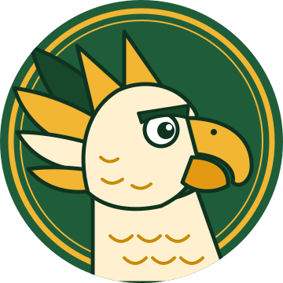
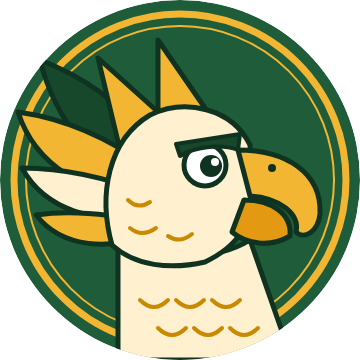

# Gale the Griffin

{ width="300" }

Gale is the mascot of the Cedar Ridge Griffins. A griffin is half eagle and half lion, so Gale
stands for sharp eyes (*aim high*) and a keen listener (*listen closely*). Gale has no gender;
write "Gale" or *they/them*.

## Identity

| | |
|---|---|
| Name | Gale |
| Species | Griffin |
| Team name | The Cedar Ridge Griffins |
| Look | Cream-feathered eagle head, gold hooked beak, gold ear tufts, green and gold wings |
| Pose | Head in profile, facing right, inside a round badge |
| Personality | Confident, upbeat, a little competitive, always cheering for the team |
| Cheer | "Griffins aim high!" |

## Colors

| Color | Hex | Used for |
|-------|-----|----------|
| Forest green | `#1F5D3A` | Badge background, school color |
| Gold | `#F2B632` | Ring, beak, ear tufts, school color |
| Cream | `#FFF1D0` | Head and chest feathers |
| Dark green | `#0F3320` | Outlines |
| Deep gold | `#C98A00` | Feather detail lines |

## Images

| File | Size | Use |
|------|------|-----|
| [griffin.svg](img/griffin.svg) | Vector | Editing and web pages |
| [griffin-360.png](img/griffin-360.png) | 360 × 360, transparent corners | The Pico's round display |

{ width="180" }

The image is drawn as a circle that fills the 360 × 360 frame, so it matches the round display
with no cropping. The PNG is for a computer; the Pico cannot decode PNG files directly. Convert
it to a raw RGB565 buffer on your computer (Chapters 5, 6, and 16 cover the display format and
how to draw the mascot), then copy that buffer to the device. The transparent corners fall
outside the visible circle of the display.

## Voice

When a device wears the Cedar Ridge edition, the agent can add a short mascot flavor to
announcements:

| Situation | Example line |
|-----------|--------------|
| Greeting | "Hi from Cedar Ridge! Gale here. What can I help you with?" |
| Test tomorrow | "Heads up: Algebra II test tomorrow at 8. Griffins aim high!" |
| Project due | "Your biology lab report is due Thursday. You've got this." |
| No school | "No school Friday. Rest up, Griffin." |
