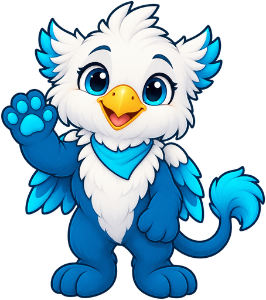

# Groves Learning Organization (GLO)

A learning organization piloting the Open Study Buddy kit.

{ width="220" }

!!! warning "Real organization: do not invent details"
    Unlike [Cedar Ridge High School](../cedar-ridge-high-school/index.md), which is fictional,
    this folder describes a real organization. Add only facts the organization has provided or
    published itself, and never put real student names or grades here.

## Profile

| Item | Value |
|------|-------|
| Name | Groves Learning Organization (GLO) |
| Slogan | *To be provided* |
| Mascot | Griffin (the Groves Griffins). The waving cartoon griffin is the GLO Coding Club mascot, from the [GLO Coding Club site](https://dmccreary.github.io/glo-coding-club/). |
| Calendar | *To be provided* |
| Colors | Groves blue `#00649B`, cyan `#01BADE` (from groveslearning.org) |
| Contact for approval | *To be provided* |

## Still To Do

- [ ] Confirm the exact name and slogan with the organization.
- [x] Get the mascot artwork: the GLO Coding Club griffin (`img/griffin-welcome.png`), used in the
  device demo at `src/schools/glo/`.
- [ ] Get permission from GLO to show the griffin on the device display.
- [ ] Get a calendar: a published academic calendar, or a hand-built `events.json` and
  `calendar.ics` (see the [Cedar Ridge calendar](../cedar-ridge-high-school/calendar.md) for the format).
- [ ] Agree on which dates, if any, may use the `TEST:` and `DUE:` title prefixes.
