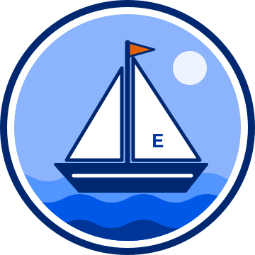

# Minnetonka Middle School East

A real public middle school (grades 6-8) in Minnetonka, Minnesota, part of Minnetonka Public
Schools, and a candidate for a kit pilot.

{ width="220" }

!!! warning "Real organization: do not invent details"
    Unlike [Cedar Ridge High School](../cedar-ridge-high-school/index.md), which is fictional,
    this folder describes a real organization. Add only facts the organization has provided or
    published itself, and never put real student names or grades here.

## Profile

| Item | Value |
|------|-------|
| Name | Minnetonka Middle School East (MME) |
| Grades | 6-8 |
| District | Minnetonka Public Schools (district teams are the Skippers) |
| Website | [minnetonkaschools.org/schools/middle-schools/mme](https://www.minnetonkaschools.org/schools/middle-schools/mme/about) |
| Slogan | *To be provided* |
| Mascot | *To be provided*. The school site lists no mascot of its own, so the sailboat above is a placeholder (see below). |
| Calendar | *To be provided* |
| Colors | Minnetonka blue `#003698`, navy `#002870`, light blue `#5395FF` (from the district website's theme) |
| Contact for approval | *To be provided* |

## Placeholder Mascot: the Lake Minnetonka Sailboat

The school website shows no mascot for Minnetonka Middle School East, so this sailboat badge was
drawn for the kit demo. It is **not** an official school mark. It nods to sailing on Lake
Minnetonka and to the district's Skippers, and it uses only colors from the district website.
Replace it if the school supplies its own artwork.

| Color | Hex | Used for |
|-------|-----|----------|
| Navy | `#002870` | Outer ring, hull, mast, outlines |
| Minnetonka blue | `#003698` | Deepest wave, sail mark, device screen background |
| Bright blue | `#0058E6` | Middle wave |
| Light blue | `#5395FF` | Top wave |
| Sky blue | `#8BB4FD` | Sky |
| Orange | `#E56100` | Pennant (the site's accent color) |

| File | Size | Use |
|------|------|-----|
| [sailboat.svg](img/sailboat.svg) | Vector | Editing and web pages |
| [sailboat-360.png](img/sailboat-360.png) | 360 x 360 | Source for the device badge (`src/schools/minnetonka-middle-school-east/`) |

## Still To Do

- [ ] Confirm the exact name and slogan with the school.
- [ ] Ask whether the school has a mascot or logo it would rather show, and get permission to use
  it on the device display. Until then the demo uses the placeholder sailboat.
- [ ] Get a calendar: a published academic calendar, or a hand-built `events.json` and
  `calendar.ics` (see the [Cedar Ridge calendar](../cedar-ridge-high-school/calendar.md) for the format).
- [ ] Agree on which dates, if any, may use the `TEST:` and `DUE:` title prefixes.
