# List of MicroSims for Open Study Buddy

MicroSims are small, interactive educational simulations — each one focused on
a single concept. Every card below links to the sim's lesson page; the same
sims are embedded in the chapters where each concept is taught.

-   **[Agent Data Flow Step-Through](./agent-data-flow-step-through/index.md)**

    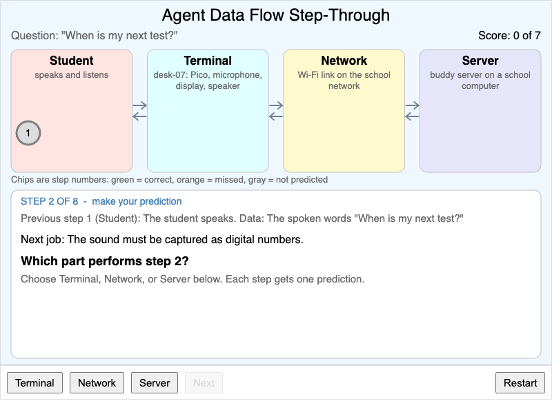

    Step through the eight hops a spoken question takes to become a spoken answer, and predict whether the terminal, network or server does each one.

-   **[Agent Hosting Trade-Off Explorer](./agent-hosting-tradeoff-explorer/index.md)**

    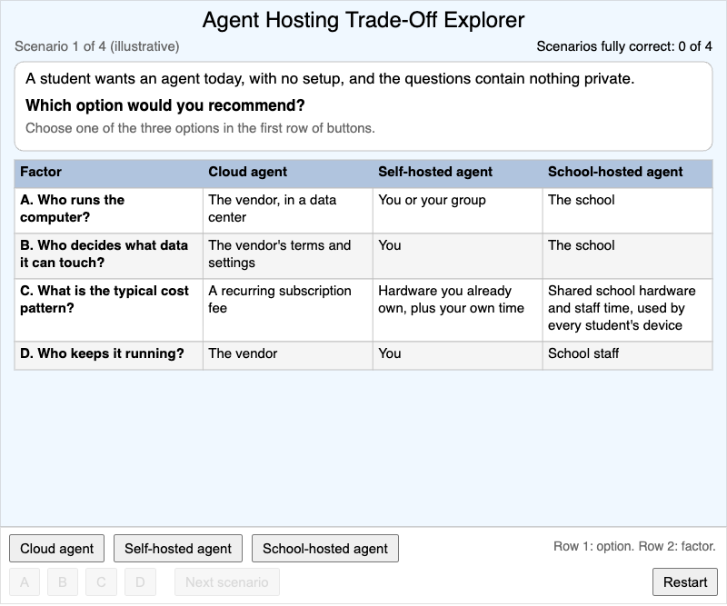

    Compare cloud, self-hosted and school-hosted agents on control, cost and privacy, then pick the best host for four classroom scenarios.

-   **[Agent Progression Level Explorer](./agent-progression-level-explorer/index.md)**

    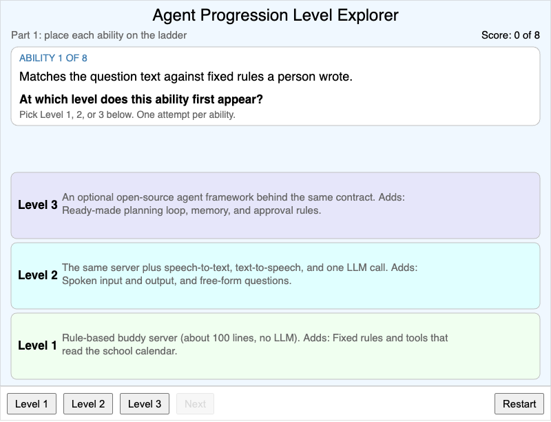

    See how the buddy server's replies grow across three agent levels while the desk terminal stays the same, then place 8 abilities by level.

-   **[Allocation Classifier](./allocation-classifier/index.md)**

    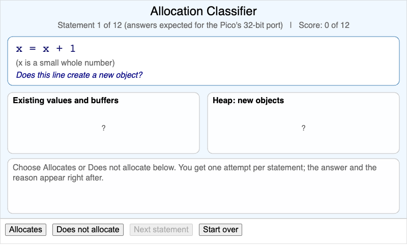

    Sort 12 MicroPython statements by whether they allocate heap memory, from small integers to buffer writes and string joins.

-   **[Audio Frame Time Budget Explorer](./audio-frame-budget-explorer/index.md)**

    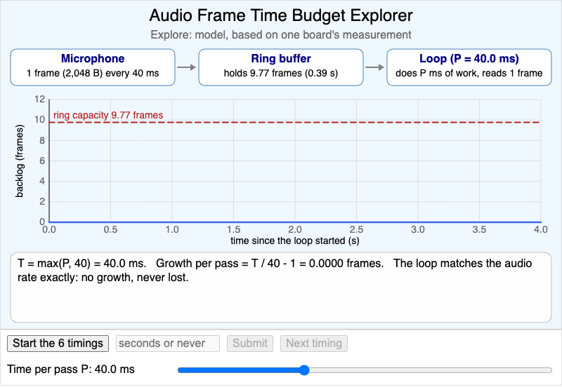

    Change the main loop's work time and watch the microphone's ring buffer keep up or overflow against the 40 ms frame budget.

-   **[Bit Depth Quantizer](./bit-depth-quantizer/index.md)**

    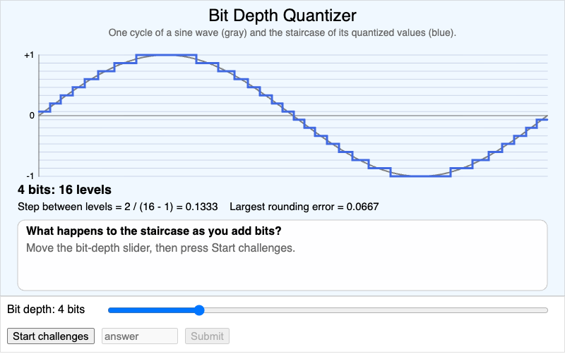

    Change the bit depth and watch a sine wave snap to 2^n levels, showing the step size and the largest rounding error.

-   **[Button Bounce and Debounce Visualizer](./debounce-bounce-visualizer/index.md)**

    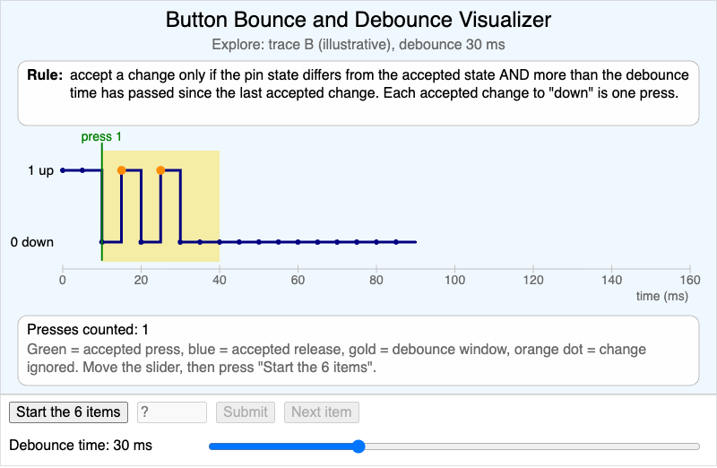

    See a button's contacts bounce on a pin trace and count how many presses the debounce rule accepts at different debounce times.

-   **[Chatbot or Agent Sorter](./chatbot-or-agent-sorter/index.md)**

    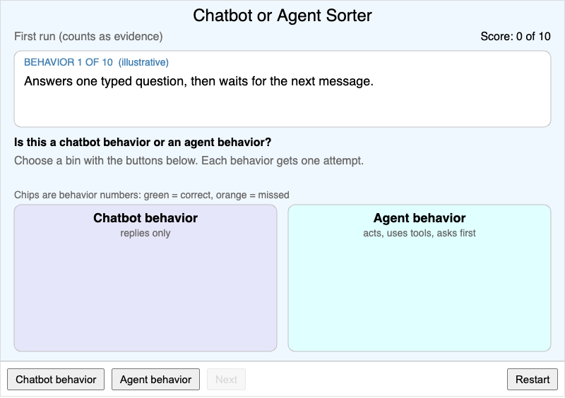

    Sort 10 described behaviors into chatbot or personal agent, using tools, multiple steps, proactive action and asking before acting.

-   **[Chunk-Size and Heap Explorer](./chunk-heap-explorer/index.md)**

    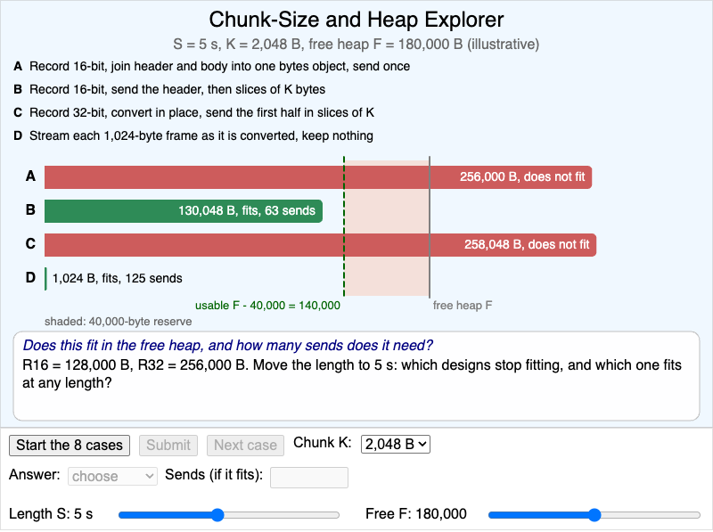

    Compare ways to upload a 128,000-byte recording and see which fit in the Pico's free heap and how many sends each one needs.

-   **[Daily Briefing Composer](./daily-briefing-composer/index.md)**

    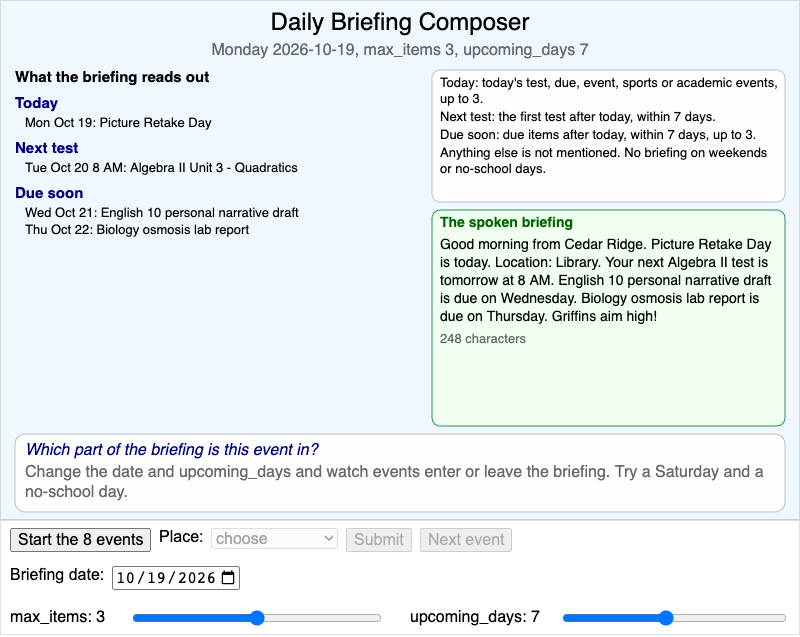

    Apply the daily briefing rules to a school calendar and sort each event into the part of the morning briefing where it is spoken, or leave it out.

-   **[Data Flow Explorer](./data-flow-explorer/index.md)**

    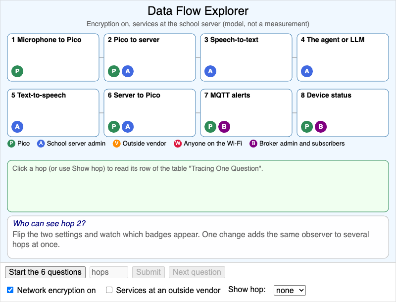

    Follow a spoken question through eight hops and toggle encryption and server location to see which observers can read the data at each hop.

-   **[Device Mode State Machine](./device-mode-state-machine/index.md)**

    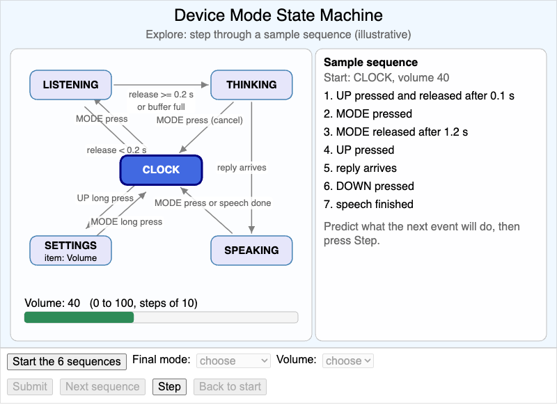

    Press the three buttons and watch the Study Buddy move between its five modes using the same transition table as the chapter.

-   **[Diagnosis Decision Tree Trainer](./diagnosis-decision-tree-trainer/index.md)**

    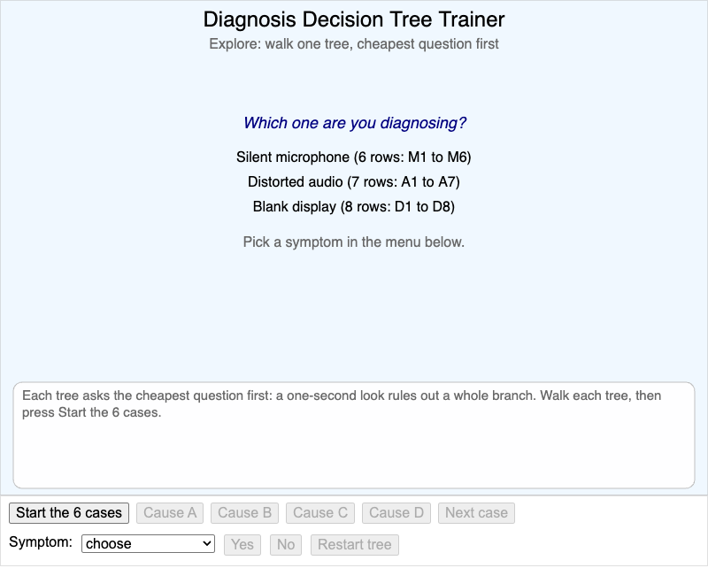

    Walk the kit's decision trees for a silent microphone, distorted audio and a blank display to find the likely cause of each reported failure.

-   **[Dirty Region Planner](./dirty-region-planner/index.md)**

    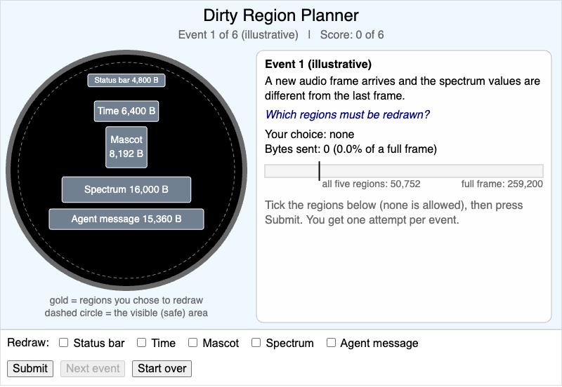

    Choose which of the round display's five regions must be redrawn after each device event, and see how many bytes each choice sends.

-   **[FFT Bin Calculator](./fft-bin-calculator/index.md)**

    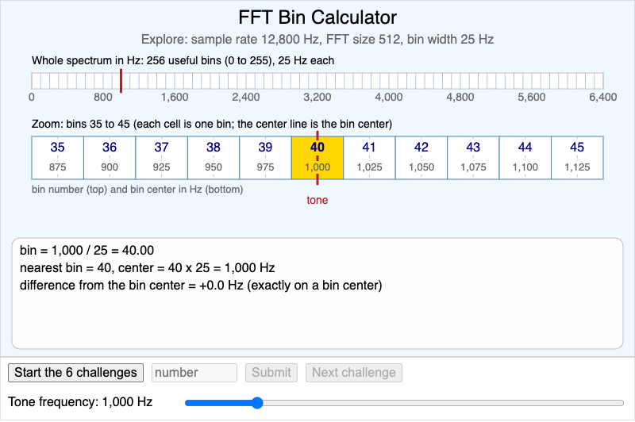

    Find the FFT bin for a tone, or the center frequency of a bin, with a 12,800 Hz sample rate and a 512-point FFT (25 Hz per bin).

-   **[Frame Budget Scheduler Timeline](./frame-budget-scheduler-timeline/index.md)**

    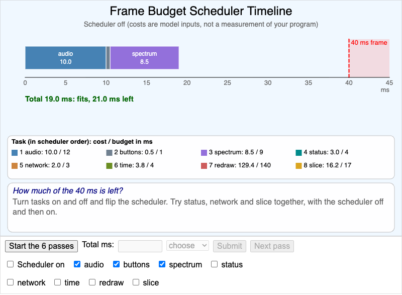

    Add up each loop pass's task costs on a timeline and see which passes fit the 40 ms audio frame and which overrun.

-   **[Frame Size and Update Time Calculator](./frame-size-calculator/index.md)**

    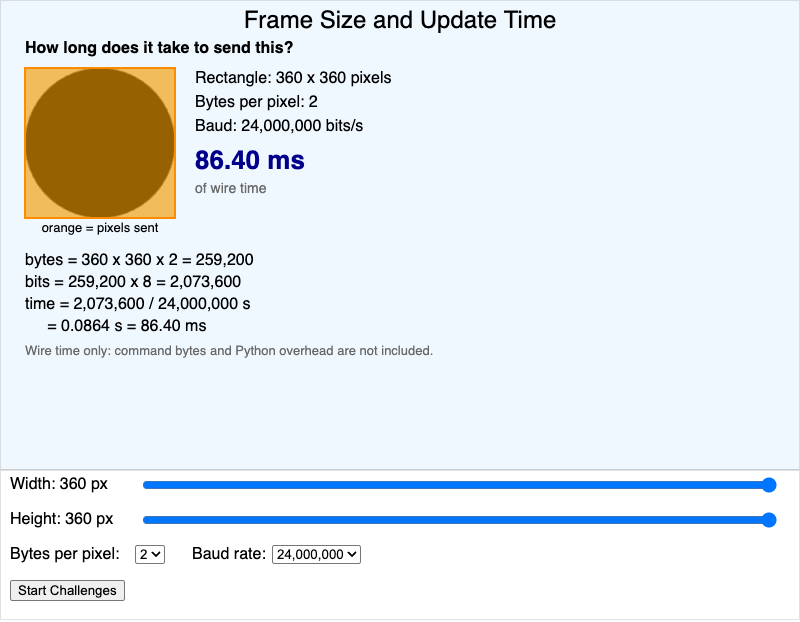

    Change a rectangle's size and the SPI baud rate to see how many bytes it holds and how long it takes to send to the 360 x 360 display.

-   **[Heap Fragmentation Explorer](./heap-fragmentation-explorer/index.md)**

    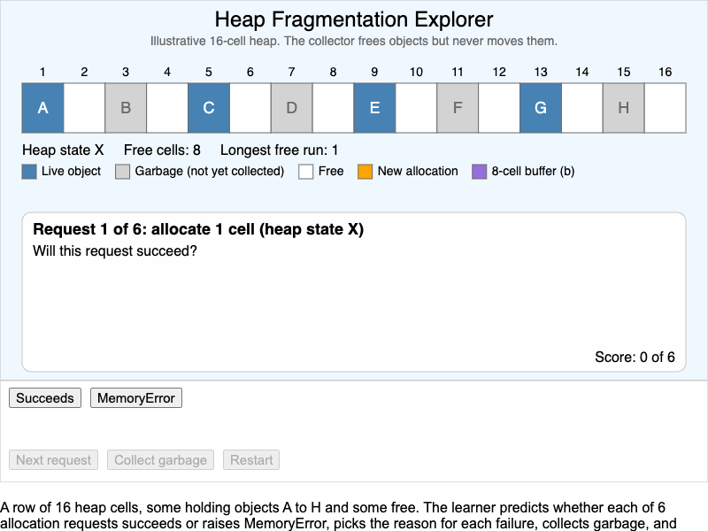

    Allocate objects on a fragmented 16-cell heap and see why a request can fail with MemoryError even when enough total memory is free.

-   **[HTTP Request Reader](./http-request-reader/index.md)**

    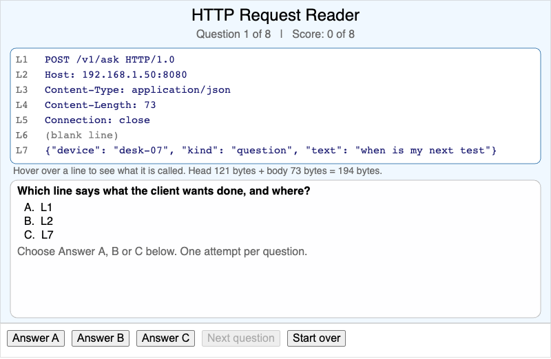

    Read the Pico's 194-byte HTTP POST to the buddy server and its reply, and answer questions about the request line, headers and JSON body.

-   **[I2S Signal Reader](./i2s-signal-reader/index.md)**

    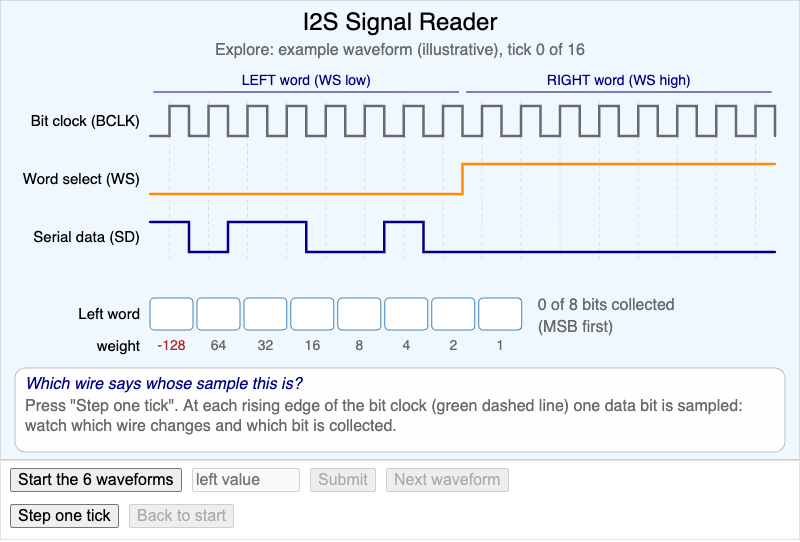

    Read the bit clock, word select and data lines of an I2S waveform to decode the left-channel sample, most significant bit first.

-   **[ICS Line Parser Stepper](./ics-line-parser-stepper/index.md)**

    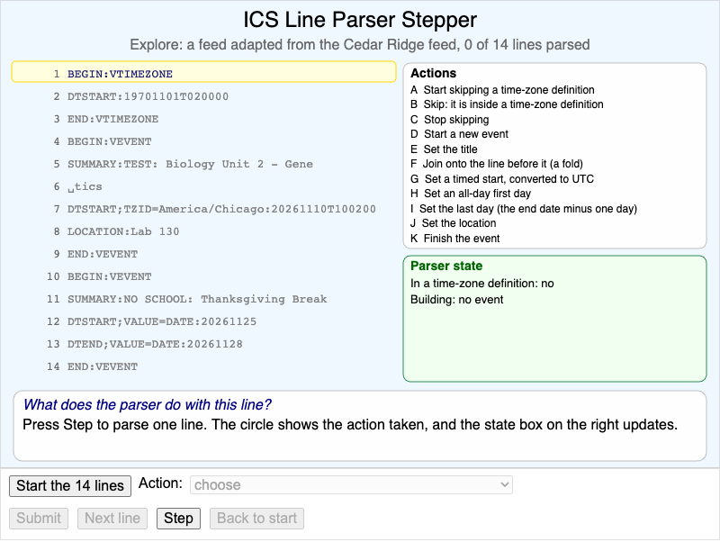

    Step through a small iCalendar feed line by line and choose what the parser does with folded lines, time zones and event fields.

-   **[Kit Import Map](./kit-import-map/index.md)**

    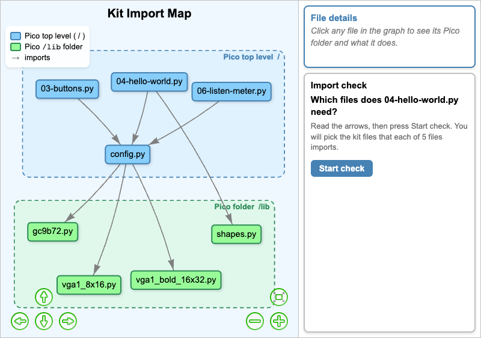

    Explore which kit files import which others, and which folder on the Pico each file belongs in.

-   **[Kit Parts Infographic](./kit-parts-infographic/index.md)**

    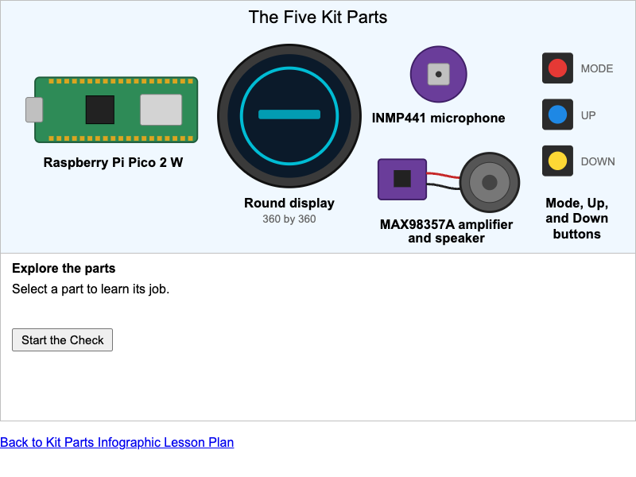

    A labeled picture of the five base-kit parts. Click a part to learn its job, then match five described jobs to the right part.

-   **[Kit Wiring Fault Finder](./kit-wiring-fault-finder/index.md)**

    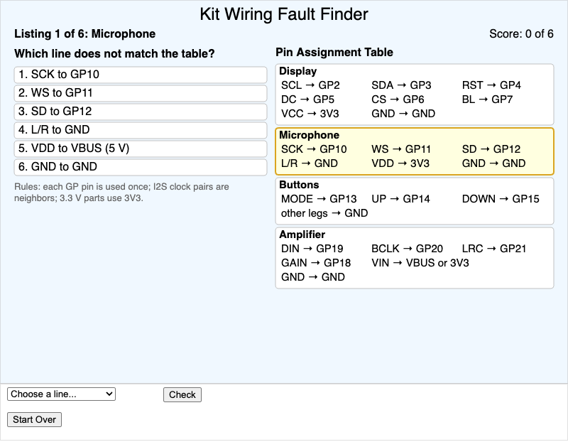

    Check six wiring listings against the kit's pin assignment table and find the one wrong connection in each.

-   **[Level Gate Hysteresis Explorer](./level-gate-hysteresis-explorer/index.md)**

    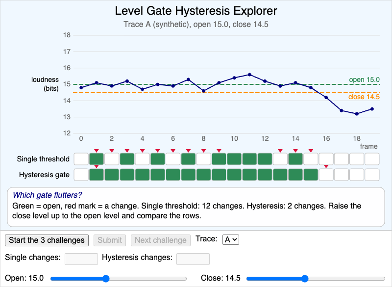

    Compare a single-threshold gate with a hysteresis gate on loudness traces and count how often each one flutters open and closed.

-   **[Log Band Layout Explorer](./log-band-layout-explorer/index.md)**

    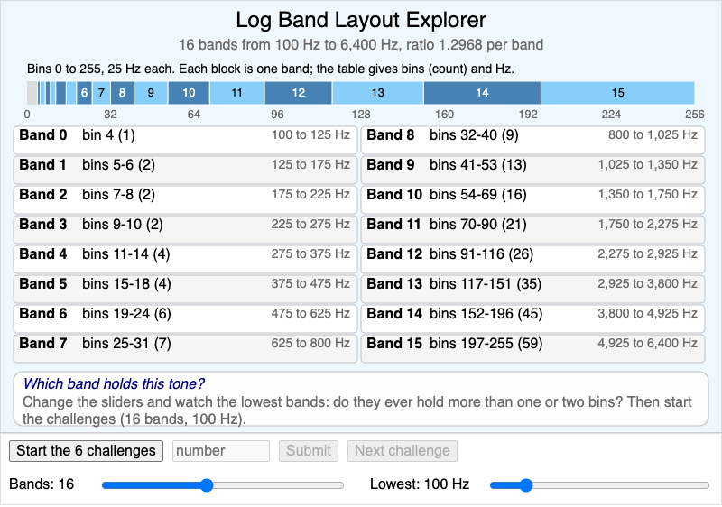

    Change the band count and lowest frequency to see how 256 FFT bins group into log-spaced bands, then find the band for a tone or its bin count.

-   **[MQTT Topic Router](./mqtt-topic-router/index.md)**

    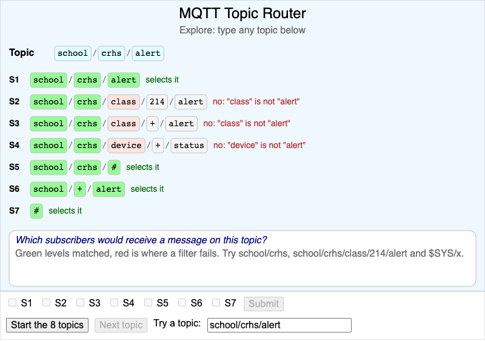

    Type an MQTT topic and see which subscription filters select it, using the + and # wildcard rules level by level.

-   **[Polling Versus Interrupt Timeline](./polling-versus-interrupt-timeline/index.md)**

    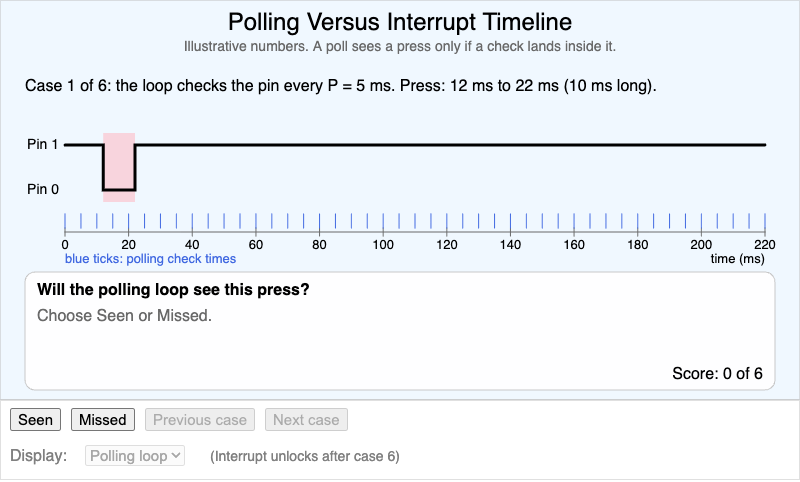

    Predict which button presses a loop that checks the pin every P ms will see, then switch to interrupt mode and watch it catch all six.

-   **[Pull-Up Button Circuit](./pull-up-button-circuit/index.md)**

    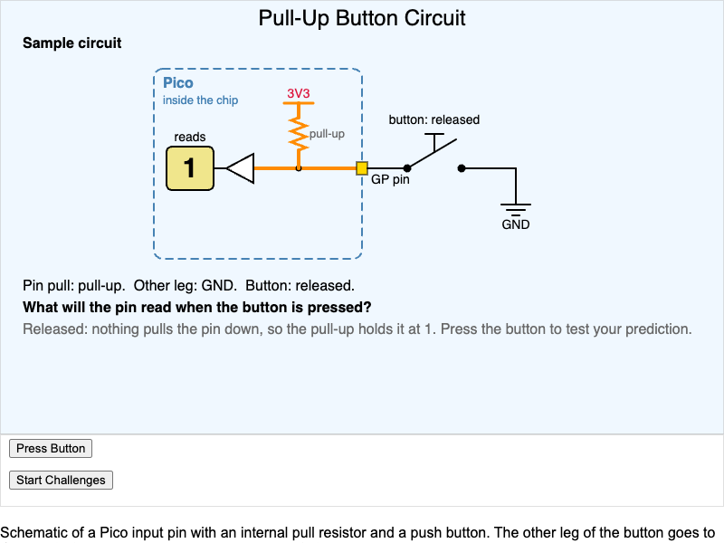

    Set a pin's pull resistor and where the button's other leg connects, then press the button to see what the GPIO pin reads.

-   **[Q15 Calculator](./q15-calculator/index.md)**

    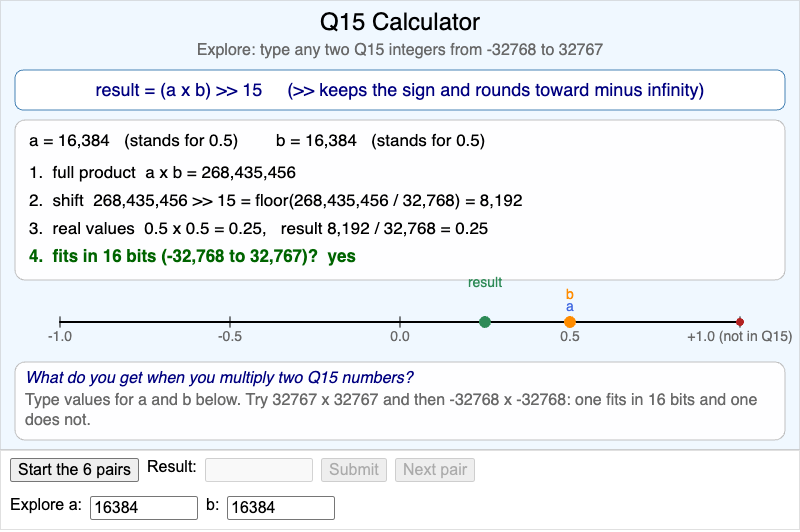

    Multiply two Q15 fixed-point numbers, shift the product right by 15, and check whether the result still fits in 16 bits.

-   **[QoS Handshake Stepper](./mqtt-qos-handshake-stepper/index.md)**

    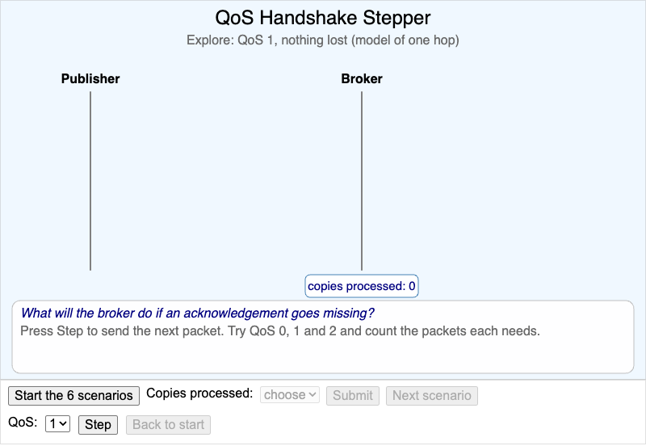

    Step through MQTT QoS 0, 1 and 2 handshakes with lost packets and count how many copies of an alert the broker processes.

-   **[Retry and Backoff Timeline Explorer](./retry-backoff-explorer/index.md)**

    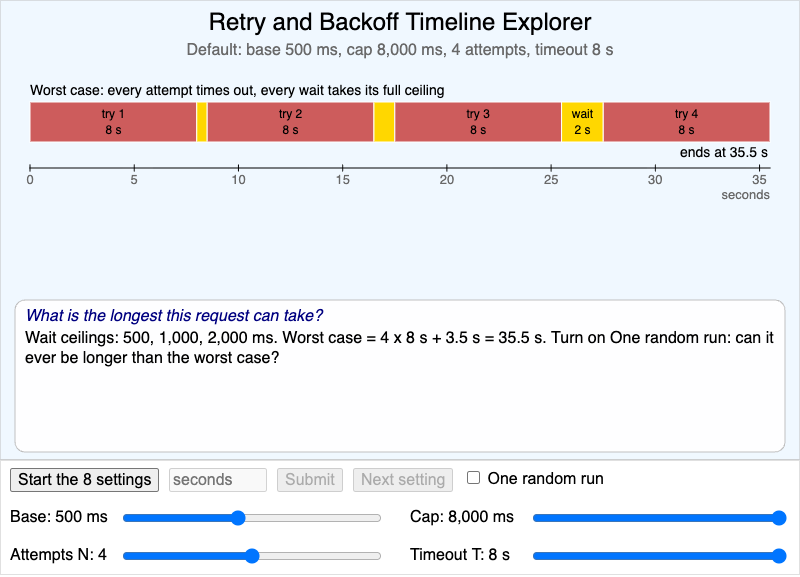

    Change attempts, timeout, base and cap to see the exponential backoff waits and the longest time a request can take.

-   **[RGB565 Color Mixer](./rgb565-color-mixer/index.md)**

    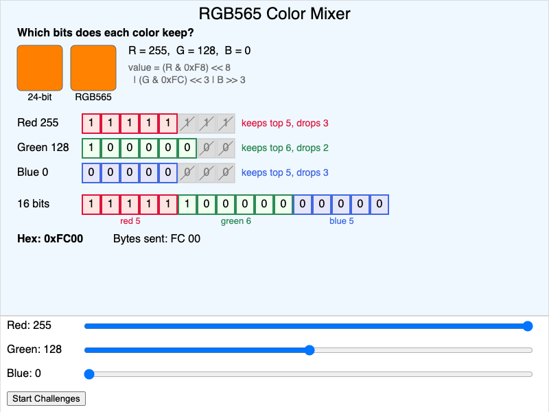

    Mix red, green and blue and watch them pack into a 16-bit RGB565 value, with the hex code and the bytes sent to the display.

-   **[Same-Subnet Checker](./same-subnet-checker/index.md)**

    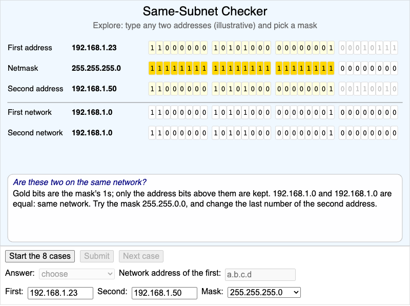

    AND two IPv4 addresses with a netmask to find their network addresses and check whether the Pico and server can talk directly.

-   **[Sampling Explorer](./sampling-explorer/index.md)**

    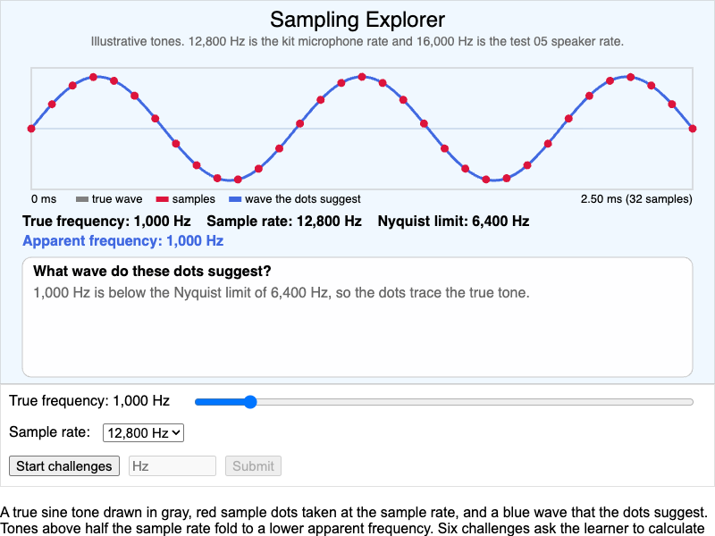

    Sample a sine tone at different rates and see aliasing appear above the Nyquist limit, with the apparent frequency shown in blue.

-   **[Spectral Leakage Explorer](./spectral-leakage-explorer/index.md)**

    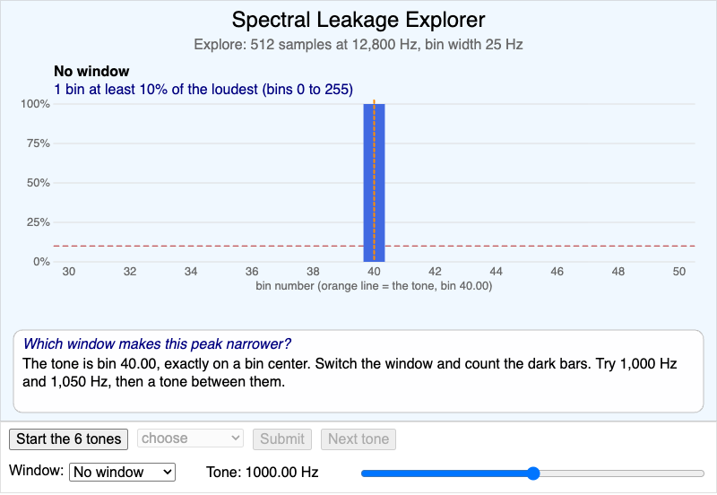

    Compare a tone's spectrum with no window and with the Hann window to see how windowing trades leakage for a wider peak.

-   **[Speed-Up Chooser](./speedup-chooser/index.md)**

    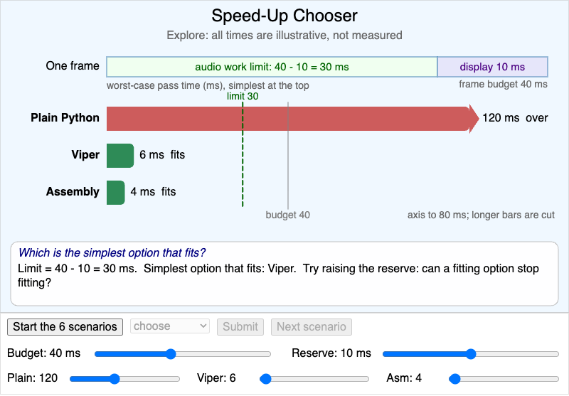

    Pick the simplest implementation, from plain Python to viper and inline assembly, whose worst-case time fits the 30 ms audio budget.

-   **[Study Buddy Architecture Explorer](./study-buddy-architecture-explorer/index.md)**

    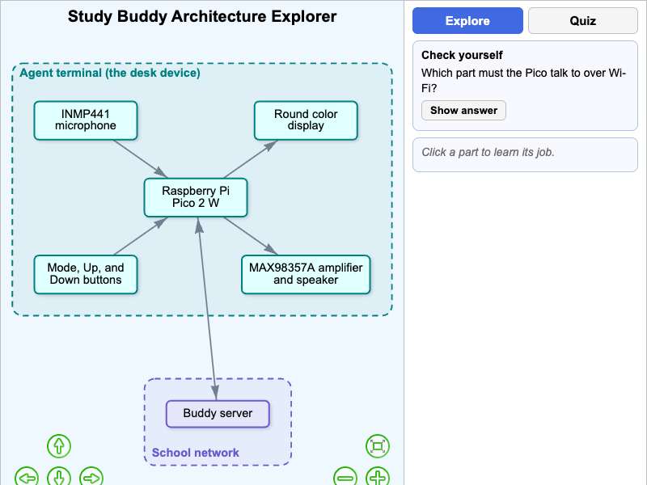

    Click each kit part and the buddy server to see its job and connections, then quiz yourself on which part does what.

-   **[Template Score Explorer](./template-score-explorer/index.md)**

    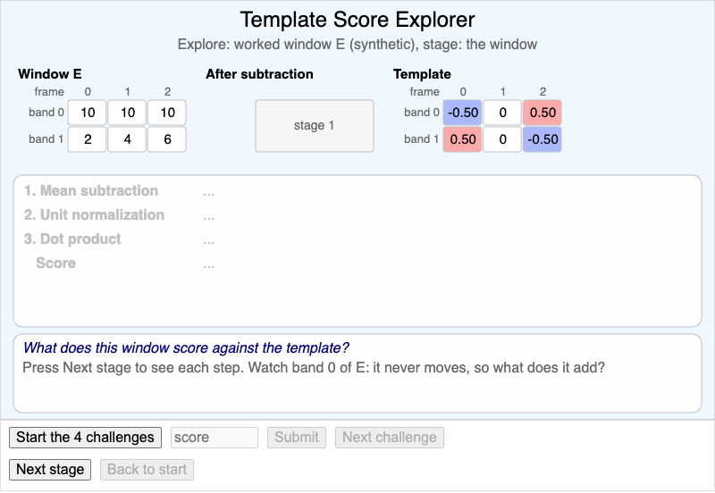

    Work through mean subtraction, normalization and a dot product to see how a wake-word window is scored against its template.

-   **[Threat Model Sorter](./threat-model-sorter/index.md)**

    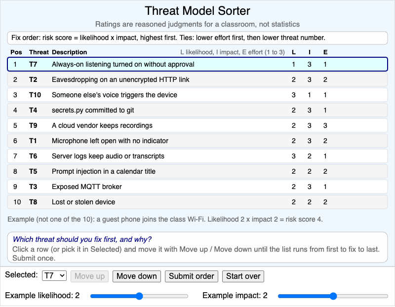

    Rank 10 classroom threats by likelihood times impact, breaking ties by effort to fix, to build a threat model's fix order.

-   **[Threshold Trade-Off Explorer](./threshold-tradeoff-explorer/index.md)**

    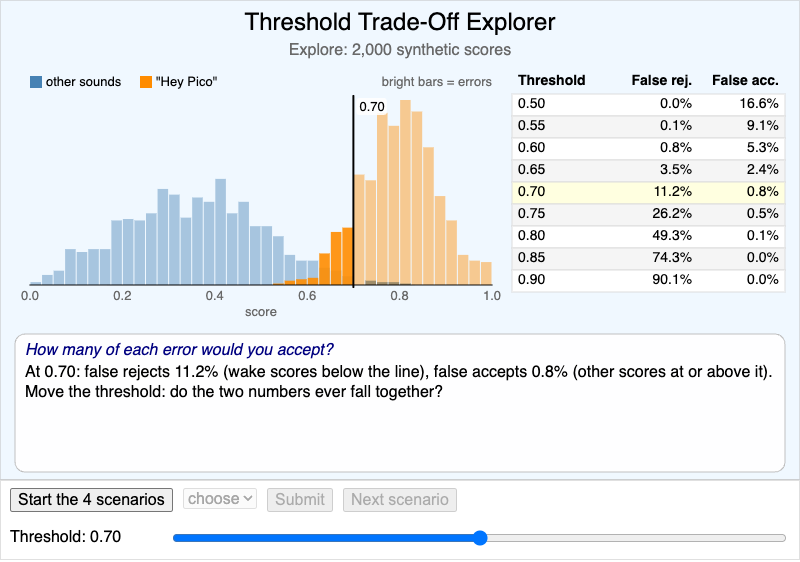

    Move a wake-word detection threshold and watch false accepts and false rejects trade off, then judge which setting meets each limit.

-   **[Time and Frequency Domain Viewer](./time-and-frequency-domain-viewer/index.md)**

    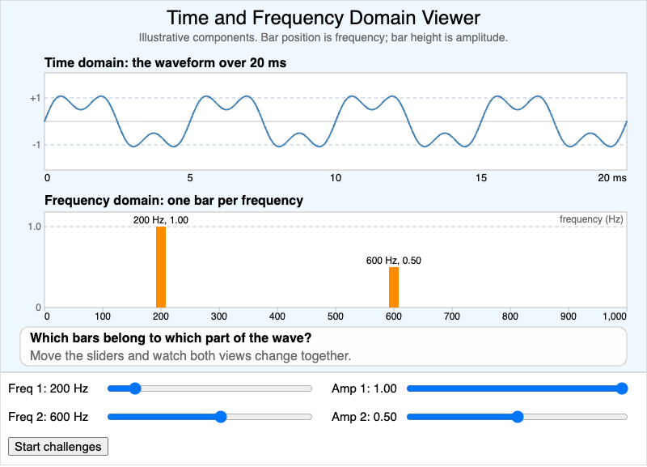

    Change two sine components and watch the waveform and frequency bar chart update together, then match spectra to waveforms.

-   **[Time Zone and UTC Converter](./school-time-utc-converter/index.md)**

    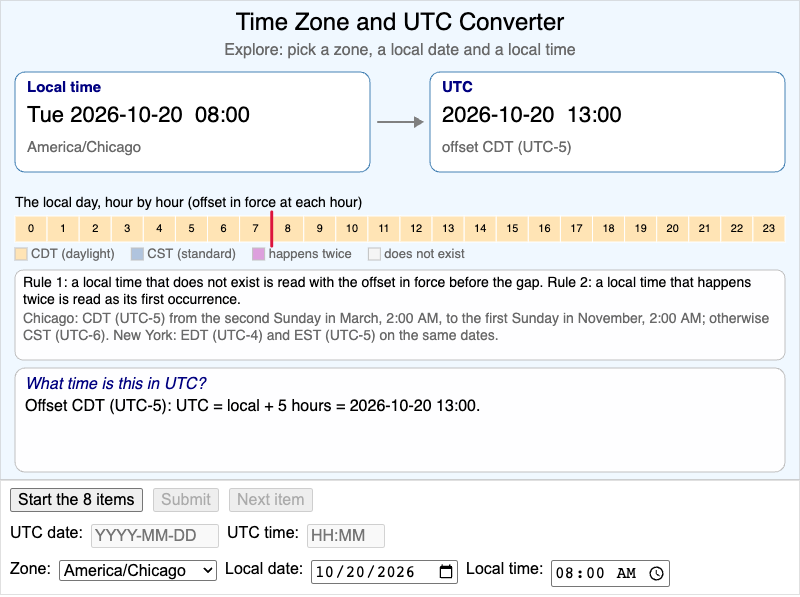

    Convert school-local Chicago times to UTC, including the skipped and repeated hours on daylight-saving change days.

-   **[VAD Boundary Finder](./vad-boundary-finder/index.md)**

    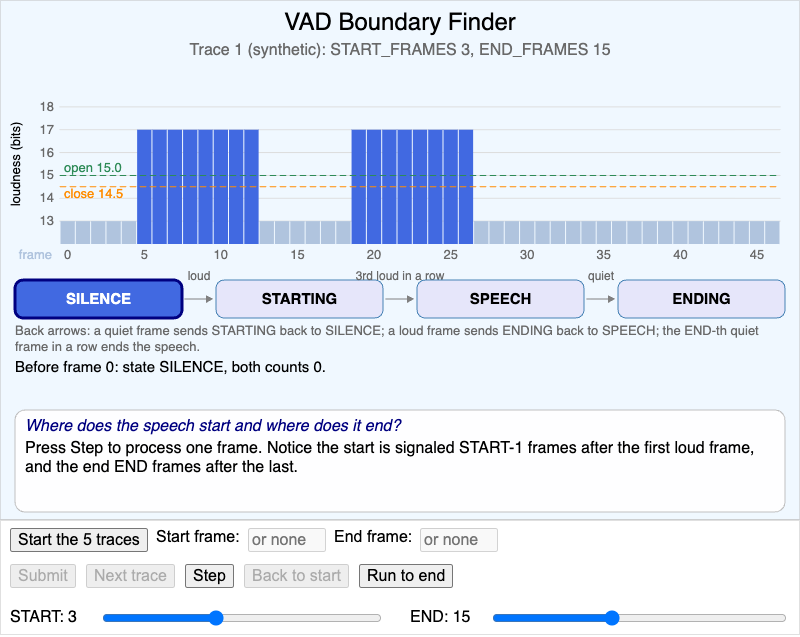

    Run the four-state voice activity detector on loudness traces and find the first and last speech frames of each recording.

